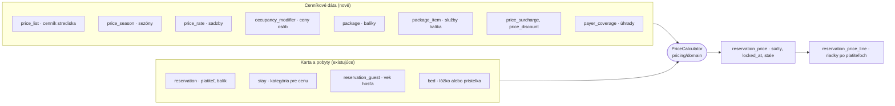

# Návrh cenotvorby – ubytovanie a balíky (TheraSuite)

| | |
|---|---|
| **Stav** | Návrh v1, na pripomienkovanie |
| **Dátum** | 24. 11. 2026 |
| **Nadväzuje na** | [`HLD-ubytovanie.md`](HLD-ubytovanie.md) (kap. 5.5 Kategória pre cenu, 5.8 Obchodný deň, 8.3 Oprávnenia) |

## 1. Cieľ, rozsah a východiská

Cenotvorba vypočíta cenu rezervačnej karty **po nociach** z cenníka podľa kategórie pre cenu, sezóny, platiteľa a obsadenosti; balíky, príplatky a zľavy sú pravidlá nad touto základnou cenou. Výsledok je uložená kalkulácia s riadkami rozdelenými medzi platiteľov, nie faktúra.

**V rozsahu**

- cenníky so sezónami a sadzbami podľa kategórie, typu ceny (za lôžko / za izbu) a obsadenosti
- pobytové balíky (ubytovanie + strava + procedúry za jednu cenu)
- príplatky (prístelka, jednolôžkové využitie, výhradné užívanie izby, skorý príchod / neskorý odchod)
- zľavy (dĺžka pobytu, včasná rezervácia, senior, promo kód, ručná zľava)
- rozdelenie ceny medzi platiteľov: poisťovňa, firma, samoplatca a doplatok klienta
- kalkulácia na karte, jej prepočet pri zmenách ubytovania a zamknutie ceny
- cenová ponuka pred založením karty

**Mimo rozsahu**: faktúry, zálohy, pokladňa, účtovanie DPH a export do účtovníctva. Kalkulácia si však pri každom riadku pamätá sadzbu DPH a platiteľa, aby na ňu fakturácia mohla nadviazať.

**Východiská v existujúcom návrhu** (`docs/HLD-ubytovanie.md`):

- `stay.price_category_id` – kategória pre cenu každého pobytu, určuje ju `PriceCategoryResolver` (kap. 5.5, UC12–UC14); cenotvorba ju preberá, neurčuje ju znova
- `stay.surcharge_category_id` – kategória, z ktorej sa počíta úhrada poisťovne (len platiteľ typu `INSURER`)
- `reservation.price_type` – `PER_BED` alebo `PER_ROOM`; pri `PER_ROOM` a jednom klientovi už resolver vybral vedľajšiu kategóriu izby (UC14)
- `reservation.payer_id`, `payer.type` = `SELF | INSURER | COMPANY`
- `reservation.exclusive_room_use`, `early_check_in`, `late_check_out` a typ lôžka (`bed.type` = `REGULAR | EXTRA`)
- obchodný deň (kap. 5.8) – „spätne“ a „dnes“ sa pri cene riadia ním, nie systémovým dátumom

Všetky ceny, sezóny a pravidlá sú **dáta** jednej inštalácie (HLD kap. 2.7), nič z nich nie je natvrdo v kóde. Návrh vychádza z bežnej praxe kúpeľov; body, ktoré musí potvrdiť zákazník, sú v poslednej kapitole.

## 2. Pojmy

| Pojem | Tabuľka | Význam |
| --- | --- | --- |
| Cenník | `price_list` | Platné ceny strediska na obdobie; môže byť všeobecný alebo pre konkrétneho platiteľa (zmluvný cenník poisťovne, firmy) |
| Sezóna | `price_season` | Časový úsek cenníka s vlastnými sadzbami (mimosezóna, hlavná sezóna, Vianoce); pri prekrytí vyhrá vyššia priorita |
| Sadzba | `price_rate` | Cena za noc (alebo za pobyt) pre kombináciu sezóna × kategória × balík × typ ceny × obsadenosť |
| Úprava ceny osoby | `occupancy_modifier` | Cena konkrétnej osoby podľa jej poradia v izbe, veku a lôžka (dieťa, tretia osoba, prístelka) |
| Balík | `package` | Pobyt za jednu cenu za noc alebo za pobyt: ubytovanie + strava + procedúry; má vlastné sadzby a minimálnu a maximálnu dĺžku |
| Služba balíka | `package_item` | Časť balíka (strava, procedúry) s vlastnou čiastkou z ceny a DPH |
| Príplatok | `price_surcharge` | Suma navyše za noc alebo jednorazovo (prístelka, jednolôžkové využitie, neskorý odchod) |
| Zľava | `price_discount` | Zníženie ceny pri splnení podmienky (dĺžka, včasná rezervácia, vek, promo kód) |
| Úhrada platiteľa | `payer_coverage` | Koľko za noc zaplatí poisťovňa alebo firma podľa zmluvy |
| Doplatok | riadok kalkulácie | Časť ceny, ktorú platí klient nad úhradu platiteľa (napr. vyššia kategória izby než hradí poisťovňa) |
| Kalkulácia | `reservation_price` + `reservation_price_line` | Uložený výsledok výpočtu ceny karty: riadky po obdobiach, hosťoch a platiteľoch |
| Zamknutá cena | `reservation_price.locked_at` | Kalkulácia, ktorá sa pri zmene cenníka už nemení; mení sa len pri zmene pobytu a len cez prepočet |

Cena za **noc** patrí dňu príchodu na lôžko, rovnako ako noc v pláne ubytovania (HLD kap. 5.1): pobyt 20. – 27. 12. má 7 nocí, posledná je 26. 12.

## 3. Faktory ceny

Cenu určujú štyri skupiny faktorov; každý sa číta z údajov, ktoré už karta a pobyty majú, okrem balíka, promo kódu a cenníkových dát.

| Faktor | Odkiaľ sa vezme | Ako ovplyvní cenu |
| --- | --- | --- |
| **Kategória pre cenu** | `stay.price_category_id` (UC12–UC14) | Vyberie riadok sadzby; po presťahovaní môže mať každý pobyt inú |
| **Sezóna** | dátum noci → `price_season` platného cenníka | Vyberie sadzbu sezóny; pobyt cez hranicu sezón má noci s rôznou cenou |
| **Platiteľ** | `reservation.payer_id` | Zmluvný cenník platiteľa má prednosť pred všeobecným; poisťovňa a firma majú úhradu (`payer_coverage`), zvyšok je doplatok klienta |
| **Balík** | `reservation.package_id` (nové) | Sadzba balíka namiesto sadzby samotného ubytovania; určí minimálnu a maximálnu dĺžku a rozpis služieb s DPH |
| **Cena za pobyt** | `price_rate.unit = PER_STAY` (nové) | Pevná suma za celý pobyt s daným počtom nocí (napr. balík 7 nocí za 690 € za osobu); noci navyše a skrátenie podľa pravidla sadzby |
| **Typ ceny** | `reservation.price_type` | `PER_BED`: cena za každého hosťa a noc; `PER_ROOM`: cena za izbu a noc bez ohľadu na počet hosťov |
| **Obsadenosť izby** | počet hosťov karty v izbe v danú noc | Sadzba pre 1, 2, 3… osoby v izbe; jednolôžkové využitie viaclôžkovej izby = príplatok alebo vlastná sadzba, len ak v izbe v tú noc nebýva hosť inej karty |
| **Prístelka** | `bed.type = EXTRA` | Sadzba prístelky (nižšia), prípadne podľa veku |
| **Vek a poradie hosťa** | `client.birth_date` k dátumu príchodu, poradie osoby v izbe | Cena osoby podľa poradia v izbe, veku a lôžka (pevná cena, percento alebo suma); senior: zľava |
| **Výhradné užívanie izby** | `reservation.exclusive_room_use` | Karta platí aj držané lôžka: príplatok za každé držané lôžko alebo cena za celú izbu |
| **Skorý príchod / neskorý odchod** | `early_check_in`, `late_check_out` | Jednorazový príplatok |
| **Dĺžka pobytu** | počet nocí karty | Zľava od N nocí (napr. 7 + 1 noc zadarmo alebo percento) |
| **Včasná rezervácia** | dátum založenia karty vs. príchod | Zľava, ak je karta založená aspoň N dní pred príchodom |
| **Promo kód / ručná zľava** | `reservation.promo_code` (nové), ručný riadok | Zľava podľa kódu; ručná zľava len s oprávnením a dôvodom |

Zľavy sa navzájom nesčítavajú, ak to pravidlo výslovne nepovolí (`stackable`): z nesčítateľných sa použije tá najvýhodnejšia pre klienta. Celková zľava je obmedzená nastavením `pricing.maxDiscountPercent`.

## 4. Dátový model

Nový modul `pricing` má dve časti: **cenníkové dáta**, ktoré spravuje administrátor alebo vedúca recepcie, a **kalkuláciu karty**, ktorú vypočíta systém. Každá tabuľka má ako ostatné `version`, `created_at/by` a `updated_at/by`; sumy sú `NUMERIC(12,2)` v mene `EUR`.

Cenníkové dáta a karta s pobytmi idú do jednej čistej funkcie; kalkulácia sa ukladá ako súčty a riadky po platiteľoch.

**Cenníkové dáta**

| Tabuľka | Stĺpce | Poznámka |
| --- | --- | --- |
| `price_list` | `centre_id`, `name`, `valid_from`, `valid_to`, `payer_id` NULL, `status` `DRAFT \| ACTIVE \| ARCHIVED` | `payer_id` = zmluvný cenník; NULL = všeobecný. Aktívny cenník sa nemení, zmena = nový cenník (kópia) |
| `price_season` | `price_list_id`, `code`, `name`, `date_from`, `date_to`, `priority` | Polootvorený interval ako pobyt; pri prekrytí vyhrá vyššia `priority` (Vianoce nad zimnou sezónou) |
| `price_rate` | `price_season_id`, `room_category_id`, `package_id` NULL, `price_type`, `occupancy`, `amount`, `extra_bed_amount`, `unit`, `nights`, `extra_night_amount`, `short_stay_rule`, `min_nights`, `max_nights` | Cena za noc; `occupancy` = počet osôb v izbe (1, 2, 3…), pri `PER_ROOM` NULL. Unikátne na (sezóna, kategória, balík, typ, obsadenosť, jednotka). `unit` = `PER_NIGHT` (predvolené) alebo `PER_STAY`: `amount` je cena za celý pobyt s `nights` nocami; každá noc navyše za `extra_night_amount` (NULL = bežná nočná sadzba); `short_stay_rule` = `PRORATE` (prepočet po nociach) alebo `FULL` (celá cena) |
| `occupancy_modifier` | `price_list_id`, `room_category_id` NULL, `person_order` NULL, `age_from`, `age_to`, `bed_type` NULL, `kind` `FIXED_PRICE \| PERCENT \| AMOUNT`, `value`, `priority` | Úprava ceny osoby podľa poradia v izbe, veku a typu lôžka, napr. „3. osoba na prístelke −30 %“, „dieťa 3–11 rokov na prístelke 20 €“, „dieťa do 3 rokov 0 €“. NULL = platí pre každé poradie, lôžko a kategóriu |
| `package` | `centre_id`, `code`, `name`, `board_type` `NONE \| BB \| HB \| FB`, `procedures_per_day`, `min_nights`, `max_nights`, `active` | Obsah balíka je popis pre recepciu a výstupy; procedúry samotné tento návrh neplánuje |
| `package_item` | `package_id`, `service_code`, `name`, `part` `ACCOMMODATION \| FOOD \| SERVICES`, `allocated_amount`, `vat_rate`, `unit` `PER_PERSON \| PER_ROOM`, `frequency` `PER_NIGHT \| PER_STAY \| PER_WEEK`, `quantity` | Služby balíka s čiastkou z jeho ceny (brutto) a DPH, napr. polpenzia 18,00 € za osobu a noc, procedúry 2× za deň; zvyšok ceny balíka sa dorovná do ubytovania (krok 8 výpočtu) |
| `price_surcharge` | `price_list_id`, `code`, `type`, `amount`, `amount_kind` `PER_NIGHT \| PER_STAY \| PERCENT`, `vat_rate` | `type`: `EXTRA_BED`, `SINGLE_USE`, `HELD_BED`, `EARLY_CHECK_IN`, `LATE_CHECK_OUT`; cena dieťaťa a ďalšej osoby je v `occupancy_modifier` |
| `price_discount` | `price_list_id`, `code`, `type`, `percent` alebo `amount`, `min_nights`, `min_days_before`, `age_from`, `promo_code`, `stackable`, `priority`, `valid_from`, `valid_to` | `type`: `LENGTH`, `EARLY_BOOKING`, `SENIOR`, `PROMO`; ručná zľava nie je pravidlo, ale riadok kalkulácie |
| `payer_coverage` | `payer_id`, `room_category_id`, `valid_from`, `valid_to`, `amount_per_night`, `covers` `ACCOMMODATION \| PACKAGE` | Úhrada poisťovne alebo firmy za noc podľa kategórie z `stay.surcharge_category_id` |

**Nové stĺpce existujúcich tabuliek**: `reservation.package_id`, `reservation.promo_code`, `reservation.price_list_id` (cenník zvolený pri potvrdení, ak sa má cena garantovať).

**Kalkulácia karty**

| Tabuľka | Stĺpce | Poznámka |
| --- | --- | --- |
| `reservation_price` | `reservation_id` (unikátne), `calculated_at`, `price_list_ids`, `total`, `total_client`, `total_payer`, `locked_at`, `locked_by`, `stale` | Posledný výsledok; `stale = true`, keď sa zmenil pobyt a prepočet ešte nebežal |
| `reservation_price_line` | `reservation_price_id`, `kind` `ACCOMMODATION \| PACKAGE \| SURCHARGE \| DISCOUNT \| COVERAGE \| MANUAL`, `stay_id` NULL, `reservation_guest_id` NULL, `date_from`, `date_to`, `nights`, `unit_amount`, `amount`, `payer_id`, `vat_rate`, `source` (kód sadzby / pravidla), `note` | Riadky sa zlúčia za rovnaké noci s rovnakou sadzbou; ručný riadok vyžaduje `note` (dôvod) |
| `reservation_price_day` | `reservation_price_id`, `date`, `part`, `service_code`, `reservation_guest_id` NULL, `payer_id`, `gross`, `vat_rate`, `net`, `vat` | Voliteľný rozpis tržby a DPH po dňoch a službách pre nočnú uzávierku a neskôr fakturáciu; súčet za kartu = `reservation_price.total` |

Kalkulácia je **snapshot**: číta sa z nej spätne, aká cena platila, aj keď sa cenník neskôr zmení. História zmien kalkulácie je v audite (zmena riadkov = `audit_change`).

## 5. Výpočet ceny

`PriceCalculator` je čistá funkcia v `pricing/domain` (unit testy bez Springu, ako `PriceCategoryResolver`): z karty, jej pobytov a cenníkových dát vráti riadky kalkulácie. Rovnaký výpočet slúži pre kartu aj pre ponuku pred jej založením.

1. **Noci a jednotky.** Pobyty karty sa rozložia na noci. Pri `PER_BED` je jednotka hosť × noc (hosť bez pobytu v danú noc sa neráta); pri `PER_ROOM` izba × noc.
2. **Cenník.** Pre každú noc aktívny cenník strediska izby platný v ten dátum: najprv zmluvný cenník platiteľa karty, inak všeobecný. Ak má karta garantovaný cenník (`reservation.price_list_id`), použije sa ten. Žiadny cenník = chyba `NO_PRICE_LIST` s dátumom.
3. **Sezóna.** Sezóna cenníka, ktorá obsahuje dátum noci, s najvyššou `priority`.
4. **Základná sadzba a úpravy osôb.** `price_rate` pre sezónu, kategóriu pre cenu pobytu (`stay.price_category_id`), balík karty, typ ceny a obsadenosť izby v tú noc. Hostia sa zoradia vždy rovnako: najprv osoby na bežných lôžkach od najstaršej, potom osoby na prístelkách, pri zhode podľa ID hosťa; poradie je `person_order`. Na každého hosťa sa uplatní jedna `occupancy_modifier`: vyhrá najkonkrétnejšia zhoda (poradie, vek, typ lôžka, kategória), pri rovnakej konkrétnosti vyššia `priority`; pravidlo s vyplneným poradím platí len pre tú osobu. Úprava dá pevnú cenu, percento alebo sumu, nikdy menej než 0. Pri `PER_ROOM` sa úpravy týkajú len osôb nad základnú kapacitu izby a na prístelkách; prístelka bez úpravy stojí `extra_bed_amount`, nikdy cenu izby. Chýbajúca sadzba = chyba `NO_RATE` s kategóriou a sezónou, nikdy cena 0.
5. **Príplatky.** Jednolôžkové využitie, len ak v izbe v tú noc nebýva nikto iný (ani hosť inej karty); držané lôžka pri výhradnom užívaní izby (za každé držané lôžko a noc); skorý príchod a neskorý odchod (raz za pobyt). Príplatok za dieťa už nie je: vek rieši `occupancy_modifier` v kroku 4.
6. **Zľavy.** Vyhodnotia sa všetky platné pravidlá cenníka. Nesčítateľné zľavy: použije sa najvyššia; sčítateľné sa pridajú podľa `priority`. Percentuálna zľava sa počíta zo základnej sadzby (nie z príplatkov), celkom najviac `pricing.maxDiscountPercent`.
7. **Platitelia.** Rozdelenie medzi platiteľa a klienta (kapitola 6).
8. **Zaokrúhlenie, zlúčenie a rozpis balíka.** Každý riadok na 2 desatinné miesta (`HALF_UP`), zlúčenie nocí s rovnakou sadzbou do jedného riadku (`20. – 23. 12., 4 noci × 55,00`), súčet = súčet riadkov. Cena balíka sa rozpíše na služby z `package_item` (čiastka × množstvo × frekvencia, s ich DPH); rozdiel medzi cenou balíka a súčtom služieb sa dorovná do položky ubytovania, takže rozpis vždy sedí na cent. Voliteľne sa uloží aj rozpis tržby a DPH po dňoch (`reservation_price_day`) pre nočnú uzávierku a neskôr fakturáciu; služba raz za týždeň sa účtuje v prvú noc každého začatého týždňa pobytu.
9. **Uloženie.** Nová kalkulácia nahradí predošlú v `reservation_price`, v jednej transakcii s auditom.

**Cena za pobyt** (`unit = PER_STAY`): sadzba sa vyberie podľa sezóny noci príchodu a platí pre celý pobyt aj cez hranicu sezón. Pri `PER_BED` je to suma za hosťa, pri `PER_ROOM` za izbu.

- **Pobyt s presne `nights` nocami**: jeden riadok „Balík N nocí“ so sumou `amount`.
- **Dlhší pobyt**: riadok balíka + noci navyše za `extra_night_amount` (NULL = bežná nočná sadzba podľa krokov 3–4).
- **Kratší pobyt** (skrátenie po založení karty): `PRORATE` = `amount` / `nights` × skutočné noci, `FULL` = celá suma. Kartu kratšiu než `nights` nemožno s balíkom založiť (chyba `PACKAGE_TOO_SHORT`).
- **Rozpočítanie na noci**: pre platiteľov, zľavy a prepočet pri presťahovaní sa suma balíka rozdelí rovnomerne na jeho noci; zvyšok po zaokrúhlení ide na poslednú noc, takže súčet sedí na cent.
- **Zľavy**: na cenu za pobyt sa uplatňujú len pravidlá, ktoré to výslovne povoľujú (zľava za dĺžku pobytu býva už v cene balíka).

Príklad (ilustračné ceny): „Relaxačný týždeň“ 7 nocí za 690,00 € za osobu, noc navyše 95,00 €. Dvaja hostia na 9 nocí zaplatia 2 × 690,00 € + 2 × 2 × 95,00 € = 1 760,00 €. Ak sa pobyt pri `PRORATE` skráti na 5 nocí, cena je 2 × 5 × 98,57 € = 985,70 €.

**Príklad** (ilustračné ceny): karta s dvoma dospelými, samoplatca, kategória Komfort 2L, cena za lôžko, pobyt 20. – 27. 12. (7 nocí), neskorý odchod. Cenník: zimná sezóna 55,00 € a Vianoce 24. – 26. 12. 75,00 € za osobu a noc pri obsadení 2 osobami, neskorý odchod 15,00 €, zľava 5 % od 7 nocí.

| Riadok | Noci | Jednotky | Sadzba | Suma |
| --- | --- | --- | --- | --- |
| Ubytovanie, zimná sezóna, 20. – 23. 12. | 4 | 2 hostia | 55,00 € | 440,00 € |
| Ubytovanie, Vianoce, 24. – 26. 12. | 3 | 2 hostia | 75,00 € | 450,00 € |
| Neskorý odchod | – | 1 | 15,00 € | 15,00 € |
| Zľava za dĺžku pobytu 5 % (zo 890,00 €) | – | – | – | −44,50 € |
| **Spolu, platí klient** | | | | **860,50 €** |

## 6. Rozdelenie ceny medzi platiteľov

Každý riadok kalkulácie má jedného platiteľa; karta platiteľa typu `INSURER` alebo `COMPANY` má preto vždy dvoch: platiteľa karty a klienta (doplatok).

| Typ platiteľa | Platí platiteľ | Platí klient |
| --- | --- | --- |
| `SELF` (samoplatca) | – | všetko |
| `INSURER` (poisťovňa) | úhradu za noc podľa `payer_coverage` pre kategóriu `stay.surcharge_category_id` (kategória, ktorú hradí poisťovňa) | rozdiel do ceny skutočnej kategórie pre cenu (doplatok za vyššiu kategóriu), príplatky, noci nad schválenú dĺžku |
| `COMPANY` (firma) | cenu podľa zmluvného cenníka až do úhrady z `payer_coverage` (bez úhrady = všetko) | to, čo zmluva nekryje (napr. príplatky, nadlimitné noci) |

**Ako sa počíta doplatok**: pre každú noc sa najprv spočíta plná cena (kroky 1–6 výpočtu). Riadok `COVERAGE` pre platiteľa = min(úhrada za noc, plná cena noci); zvyšok tej noci je riadok klienta. Úhrada nikdy nepresiahne plnú cenu a zľavy znižujú najprv časť klienta.

**Príklad** (ilustračné ceny): klient poisťovne býva 10 nocí v kategórii Komfort 1L za 70,00 € za noc; poisťovňa hradí kategóriu Štandard 2L s úhradou 48,00 € za noc. Poisťovňa zaplatí 480,00 €, klient doplatok 220,00 € (10 × 22,00 €).

Noci mimo schváleného obdobia poisťovne (predĺžený pobyt) majú platiteľa klienta celé. Schválené obdobie dnes v dátach nie je; návrh: zmluvné noci = termín karty v čase jej založenia, čo potvrdí zákazník.

## 7. Zmeny a zamknutie ceny

Kalkulácia sa prepočíta automaticky pri každej zmene, ktorá mení jej vstupy; zmena cenníka už potvrdenú cenu nemení. Pravidlo zo zvyklostí hotelov: **cena sa garantuje pri potvrdení rezervácie, platí cenník platný pre dátum noci**.

| Udalosť | Čo sa stane s cenou |
| --- | --- |
| Založenie karty, pridelenie lôžka | Prvý výpočet; karta si zapamätá použité cenníky (`reservation_price.price_list_ids`) |
| Presťahovanie, zmena dĺžky, výmena (UC7–UC11) | Prepočet v tej istej transakcii ako zmena pobytu; nové noci podľa cenníka platného pre ich dátum |
| Zmena kategórie pre cenu, typu ceny (UC12–UC14) | Prepočet |
| Zmena platiteľa, balíka, promo kódu, hostí | Prepočet; zmena platiteľa po príchode len s oprávnením `PRICE_OVERRIDE` |
| Nový alebo upravený cenník | Existujúce kalkulácie sa **nemenia**; recepcia môže kartu prepočítať ručne a uvidí rozdiel pred potvrdením |
| Odchod (check-out) | Kalkulácia sa **zamkne** (`locked_at`); ďalšia zmena len s `PRICE_OVERRIDE` a dôvodom |
| Storno, neprišiel | Kalkulácia sa zachová v audite; storno poplatky sú otvorená otázka |

**Prepočet počas ubytovania nikdy nezlyhá kvôli cene**: ak chýba sadzba (`NO_RATE`), zmena pobytu prejde a kalkulácia dostane `stale = true` s upozornením. Recepcia vidí na karte „Cena nie je aktuálna“ a nočná uzávierka to hlási ako zistenie na vedomie (nové pravidlo `PRICE_STALE`).

**Ručná úprava**: riadok `MANUAL` (zľava alebo príplatok) s povinným dôvodom. Limit percenta ručnej zľavy je číslo pri roli, rovnako ako limit nocí pri `STAY_CREATE` (HLD kap. 8.3). Prepočet ručné riadky zachová.

## 8. REST API, oprávnenia a audit

Všetky endpointy sú pod `/api`, chyby v jednotnom formáte `ProblemDetail` (HLD kap. 6.3), každý zápis cez `@AuditedOperation`.

| Endpoint | Účel | Oprávnenie |
| --- | --- | --- |
| `GET /reservations/{id}/price` | Kalkulácia karty s riadkami a súčtami za platiteľa a klienta | `PRICE_VIEW` |
| `POST /reservations/{id}/price/preview` | „Čo ak“: výpočet so zmenenými vstupmi (balík, promo kód, cenník) bez uloženia; rozdiel oproti uloženej cene | `PRICE_VIEW` |
| `POST /reservations/{id}/price/recalculate` | Prepočet podľa aktuálnych cenníkov (aj pri `stale`) | `PRICE_EDIT` |
| `POST /reservations/{id}/price/manual-lines`, `DELETE …/manual-lines/{lineId}` | Ručná zľava alebo príplatok s dôvodom | `PRICE_OVERRIDE` (limit %) |
| `POST /reservations/{id}/price/lock`, `/unlock` | Zamknutie a odomknutie ceny | `PRICE_OVERRIDE` |
| `POST /pricing/quote` | Ponuka pred založením karty: stredisko, kategória, termín, hostia s vekom, platiteľ, balík | `PRICE_VIEW` |
| `GET/POST/PATCH /price-lists`, `POST /price-lists/{id}/copy`, `/activate`, `/archive` | Správa cenníkov; aktívny cenník sa nemení, mení sa jeho kópia | `PRICE_LIST_EDIT` |
| `GET/PUT /price-lists/{id}/seasons`, `/rates`, `/modifiers`, `/surcharges`, `/discounts` | Sezóny, sadzby (tabuľka kategória × sezóna), úpravy osôb, príplatky, zľavy | `PRICE_LIST_EDIT` |
| `GET/POST/PATCH /packages`, `/packages/{id}/items`, `/payers/{id}/coverage` | Balíky, ich služby a úhrady platiteľov | `PRICE_LIST_EDIT` |

**Nové oprávnenia** (modul `pricing`, HLD kap. 8.3):

| Oprávnenie | Limit | Recepčná | Vedúca recepcie | Administrátor |
| --- | --- | --- | --- | --- |
| `PRICE_VIEW` – vidieť cenu a ponuku | – | áno | áno | áno |
| `PRICE_EDIT` – prepočítať cenu | – | áno | áno | – |
| `PRICE_OVERRIDE` – ručná zľava, odomknutie ceny | max. % zľavy | 10 % | 100 % | – |
| `PRICE_LIST_EDIT` – cenníky, balíky, úhrady | – | – | áno | áno |

Limity v tabuľke sú návrh a menia sa pri roli, nie v kóde. Audit: zmena cenníka zapíše `audit_change` s hodnotami pred a po; kalkulácia karty sa zapisuje spolu so zmenou, ktorá ju vyvolala (jedna udalosť auditu). Ceny nie sú osobné údaje, čítanie kalkulácie sa preto neaudituje, okrem mien hostí v riadkoch (podľa HLD kap. 7.4).

## 9. Otvorené otázky a návrh tiketov

**Na overenie so zákazníkom**

- [ ] Platí cena podľa cenníka v dátum noci (návrh), alebo podľa cenníka v dátum založenia karty (garantovaná cena pre celý pobyt)?
- [ ] Je cena za lôžko a noc, alebo za izbu a noc, a líši sa podľa strediska alebo platiteľa?
- [ ] Aké balíky majú (názov, strava, počet procedúr za deň, minimálna dĺžka) a aké je rozdelenie DPH medzi ubytovanie, stravu a služby?
- [ ] Ako fungujú zmluvy s poisťovňami: úhrada za noc podľa kategórie, schválený počet nocí, ako sa označí doplatok?
- [ ] Vekové hranice dieťaťa a seniora a aké zľavy sa navzájom sčítavajú?
- [ ] Platí sa za držané lôžka pri výhradnom užívaní izby plná cena, príplatok, alebo cena za celú izbu?
- [ ] Storno poplatky a poplatok za „neprišiel“: sú v rozsahu cenotvorby?
- [ ] Miestny poplatok (daň z ubytovania) počíta cenotvorba, alebo až fakturácia?
- [ ] Kto spravuje cenníky: vedúca recepcie, administrátor, alebo obchodné oddelenie?
- [ ] Aké balíky s pevnou cenou za pobyt ponúkajú (počet nocí, cena za osobu alebo izbu), koľko stojí noc navyše a čo sa stane pri skrátení pobytu: prepočet po nociach alebo celá cena?
- [ ] Aké ceny majú ďalšie osoby v izbe: tretia osoba, dieťa podľa veku na bežnom lôžku a na prístelke, dieťa bez lôžka? Kto je „prvá osoba“, ak sú v izbe len deti alebo rôzni platitelia?
- [ ] Aké čiastky z ceny balíka pripadajú na stravu a procedúry (pre DPH) a má sa tržba účtovať po dňoch pri nočnej uzávierke?

**Návrh tiketov** (poradie = závislosti)

| # | Tiket | Výsledok |
| --- | --- | --- |
| C1 | Modul `pricing`: migrácie cenníkov, sezón, sadzieb, úprav osôb, balíkov a ich služieb, príplatkov, zliav a úhrad; nové stĺpce karty; oprávnenia | Schéma a seed demo cenníka |
| C2 | `PriceCalculator` v `pricing/domain` s unit testami (sezóny, obsadenosť, poradie a vek osôb, prístelka, cena za pobyt, zľavy, rozpis balíka, zaokrúhlenie) | Jadro výpočtu |
| C3 | Rozdelenie medzi platiteľov a doplatok | `COVERAGE` riadky |
| C4 | Kalkulácia karty: uloženie, prepočet pri zmenách pobytu, `stale`, zamknutie pri odchode, pravidlo uzávierky `PRICE_STALE`, voliteľný rozpis po dňoch | Cena na karte vždy aktuálna |
| C5 | API ceny karty, ponuka (`/pricing/quote`), ručné riadky | Endpointy s testami |
| C6 | Správa cenníkov: API + kópia a aktivácia | Cenníky ako dáta |
| F-C1 | Frontend: cena na detaile karty a v bočnom paneli plánu, náhľad zmeny ceny pri presťahovaní | Recepcia vidí cenu |
| F-C2 | Frontend: ponuka pri novej rezervácii | Cena pred založením karty |
| F-C3 | Frontend: správa cenníkov (mriežka sadzieb kategória × sezóna) | Údržba cien bez vývojára |
