# High-level design – backend ubytovania (recepcia kúpeľov)

| | |
|---|---|
| **Stav** | Návrh v4, na pripomienkovanie |
| **Dátum** | 14. 11. 2026 |
| **Vstupy** | `1005_usecasy_recepcna_ubytovanie.xlsx` (UC1–UC24), `iszp_klient_ubytovanie.sqlite` (pôvodná databáza – **len na vysvetlenie domény**) |
| **Rozsah** | Backend v Spring Boote pre agendu recepčnej: ubytovanie, zmeny ubytovania, kategória pre cenu, plán ubytovania, blokácie, kontingenty, používatelia, audit, obchodný deň |

**Zmeny vo v4 (druhé kolo rozhodnutí, 14. 11. 2026)**
- Nasadenie **na serveri zákazníka v internej sieti** cez Docker Compose (kap. 2.6).
- Systém je **produkt pre viac kúpeľov**: jedna inštalácia na zákazníka, nič špecifické pre jedny kúpele nie je v kóde (kap. 2.7).
- Lekár vidí **len svojich pacientov**, ale môže si pacienta **preradiť** s povinnou poznámkou; pôvodný lekár dostane **oznámenie** (kap. 8.5).
- Archív auditu sa uchováva **2 roky** (konfigurovateľne) a potom sa zmaže (kap. 7.5).
- „Dnešný deň“ sa mení **po nočnej uzávierke recepcie** (obchodný deň, kap. 5.8).
- Zmeny v pláne ubytovania sa ostatným používateľom zobrazia **hneď naživo** (kap. 6.4).
- Import z online rezervačného systému je **odložený do 2. generácie** (kap. 5.9 obsahuje len smer riešenia).
- Kúpele môžu mať **viac recepcií**; každá má vlastný obchodný deň a vlastnú uzávierku (kap. 5.8).
- Obsah nočnej uzávierky je **návrh na overenie s recepciou zákazníka** (kap. 5.8).
- Inštaláciu a aktualizácie robíme **spolu so zákazníkom**, so zdieľanými zodpovednosťami (kap. 2.6).
- E-mailové oznámenia sa **zapínajú začiarkavacím políčkom** (kap. 8.5, 9).

**Zmeny vo v3**
- Databáza: **PostgreSQL** vo všetkých prostrediach, SQLite sa už nepoužíva (kap. 2.4).
- Prihlásenie: **lokálne účty**, ktoré zakladá administrátor (kap. 8.4).
- Názov **držané lôžko** je potvrdený.
- Audituje sa aj **čítanie osobných údajov** klienta (kap. 7.4).
- Audit sa uchováva **konfigurovateľne, predvolene 6 mesiacov** (kap. 7.5).
- Limit nocí je číslo pri role, **365 = bez obmedzenia** (kap. 8.3).
- Pribudla rola **lekár** a výstup **zoznam hostí s miestom ubytovania** (kap. 8.5).
- Farby a nastavenia plánu sa ukladajú **na používateľa** (kap. 9).

**Zmeny vo v2**
- Vlastný dátový model: tabuľky aj stĺpce majú anglické názvy. Pôvodná databáza slúži len na pochopenie pojmov (mapovanie v kap. 11).
- Pojem „duch“ je nahradený pojmom **držané lôžko** (*held bed*) a modeluje sa ako výhradné užívanie izby, nie ako fiktívny pobyt.
- Prístelka je **extra lôžko** izby, teda samostatné lôžko s typom `EXTRA`.
- Každému zápisu predchádza **audit záznam** (kap. 7).
- Pribudol **model používateľov, rolí a oprávnení**, teda aktérov systému (kap. 8).

---

## 1. Cieľ a rozsah

Backend poskytuje REST API, nad ktorým bude frontend (React) zobrazovať **plán ubytovania** a recepčná v ňom bude ubytovávať, sťahovať a blokovať izby.

**V rozsahu**
- ubytovanie klienta z rezervačnej karty, z plánu ubytovania a hromadne pre skupinu (UC1–UC6)
- zmeny ubytovania: sťahovanie celého pobytu alebo jeho časti, zmena dĺžky, výmena dvoch klientov (UC7–UC11)
- určenie kategórie, podľa ktorej sa počíta cena (UC12–UC14)
- plán ubytovania, filtre izieb, voľné izby, blokácie (UC15–UC20)
- kontingenty a turnusy (UC21–UC24)
- používatelia, roly, oprávnenia, audit všetkých zápisov a čítania osobných údajov
- zoznam hostí s miestom ubytovania pre lekárov, preradenie pacienta a oznámenia
- recepcie, obchodný deň a nočná uzávierka (každá recepcia zvlášť)
- živé aktualizácie plánu ubytovania

**Mimo rozsahu (v1)**
- výpočet ceny a fakturácia (backend určí len *kategóriu pre cenu*, nie sumu)
- zdravotná časť karty (diagnózy, procedúry), okrem pridelenia lekára pri ubytovaní (UC1)
- napojenie na poisťovne a channel managery
- **import rezervácií z online rezervačného systému a odosielanie voľnej kapacity – 2. generácia** (kap. 5.9)

---

## 2. Architektúra

### 2.1 Kontext

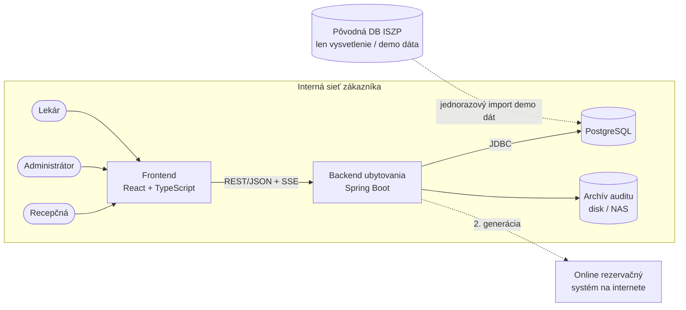

### 2.2 Technológie

| Oblasť | Voľba | Poznámka |
|---|---|---|
| Jazyk | Java 25 | |
| Framework | Spring Boot 4 (Web MVC, Data JPA, Validation, Security) | |
| Štruktúra | Modulárny monolit, voliteľne Spring Modulith na kontrolu závislostí | jeden deployment, jasné hranice modulov |
| Databáza | PostgreSQL 17 vo všetkých prostrediach | vývoj cez Docker Compose, testy cez Testcontainers (kap. 2.4) |
| Schéma | Flyway | `V1__init.sql` vytvorí celú novú schému |
| Plánované úlohy | Spring `@Scheduled` + ShedLock | archivácia auditu, pripomienka uzávierky |
| Živé aktualizácie | Server-Sent Events (`SseEmitter`) | zmeny plánu a oznámenia (kap. 6.4) |
| Nasadenie | Docker image + Docker Compose | server zákazníka v internej sieti (kap. 2.6) |
| API dokumentácia | springdoc-openapi (Swagger UI) | kontrakt pre frontend |
| Chyby | `ProblemDetail` (RFC 9457) | |
| Testy | JUnit 5, Spring Boot Test, ArchUnit | |

### 2.3 Vrstvy v každom module

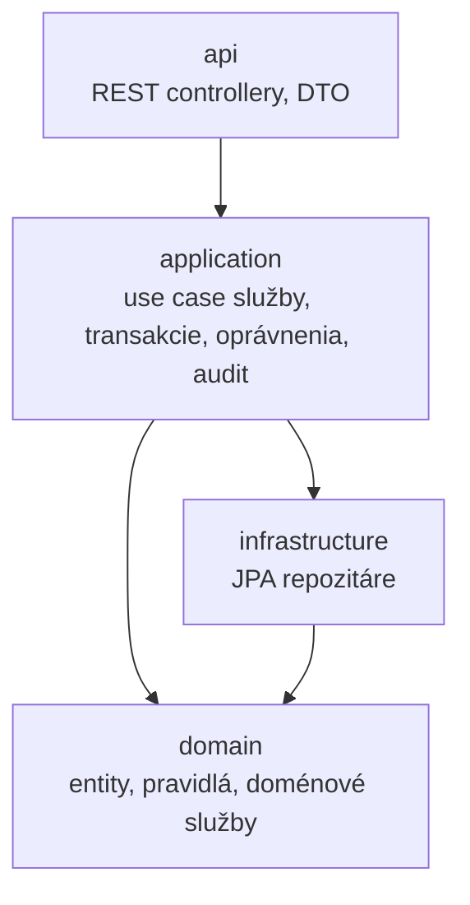

- **api** – len prevod HTTP ↔ príkaz, žiadna logika.
- **application** – jeden use case = jedna metóda služby = jedna transakcia s jedným audit záznamom (napr. `StayService.move(...)`).
- **domain** – pravidlá obsadenosti, intervaly, kategória pre cenu. Testuje sa unit testami bez Springu.
- **infrastructure** – JPA repozitáre a dotazy.

### 2.4 Voľba databázy

**Rozhodnutie: PostgreSQL vo všetkých prostrediach** (vývoj, testy, CI aj produkcia).

| Možnosť | Na čo je | Vhodnosť pre tento systém |
|---|---|---|
| **PostgreSQL** | Relačná databáza s transakciami a obmedzeniami | **Áno.** Dáta sú relačné (izby, lôžka, pobyty, používatelia) a kľúčové je, aby sa dva pobyty na jednom lôžku nikdy neprekrývali |
| SQLite | Vstavaná databáza v jednom súbore | Len na rýchly prototyp. Zapisuje naraz len jedno spojenie, nemá obmedzenia na prekrývanie intervalov ani partície. Dve rôzne databázy (vývoj vs. produkcia) by znamenali chyby, ktoré sa objavia až v produkcii |
| Elasticsearch | Fulltextové vyhľadávanie a analýza logov | **Nie ako hlavná databáza** – nemá transakcie ani cudzie kľúče. Dal by sa doplniť neskôr, ak bude treba rýchlo hľadať v miliónoch audit záznamov. Na začiatok stačí PostgreSQL (indexy, `pg_trgm` na hľadanie podľa mena) |
| Protocol Buffers | Formát správ medzi službami (gRPC) | **Nie je to databáza.** Rieši prenos dát, nie ich ukladanie. Pre React frontend je prirodzenejší REST/JSON. Má zmysel až pri komunikácii backend ↔ backend s vysokou záťažou |

**Čo PostgreSQL prinesie navyše**
- **Ochrana pred prekrývaním priamo v databáze.** Aj pri chybe v kóde sa nepodarí uložiť dva pobyty na to isté lôžko v rovnakom čase:
  ```sql
  CREATE EXTENSION IF NOT EXISTS btree_gist;
  ALTER TABLE stay ADD CONSTRAINT stay_no_overlap
    EXCLUDE USING gist (bed_id WITH =, daterange(date_from, date_to, '[)') WITH &&);
  ```
  Rovnako pre `room_block` na úrovni izby.
- **Partície auditu po mesiacoch.** Mazanie po uplynutí doby uchovávania je zmazanie celej partície, nie pomalý `DELETE` miliónov riadkov.
- **`jsonb`** pre stav pred a po zmene v audite, s možnosťou v ňom vyhľadávať.
- **Rovnaké prostredie všade:** lokálne cez Docker Compose, v testoch a v CI (aj pre AI agenta na GitHube) cez Testcontainers.

Pôvodná SQLite databáza zostáva len ako vysvetlenie domény a zdroj demo dát.

### 2.5 Moduly

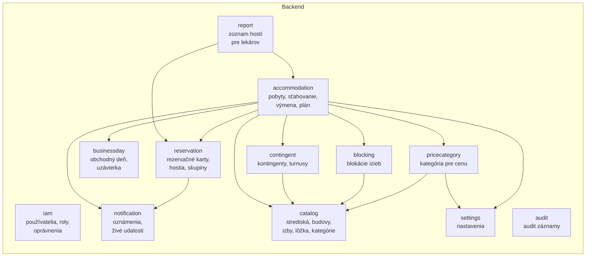

Moduly `iam` a `audit` používajú všetky ostatné moduly; v diagrame ich šípky kvôli prehľadnosti nie sú.

| Modul | Zodpovednosť | Use casy |
|---|---|---|
| `iam` | Používatelia, roly, oprávnenia, rozsah na strediská, prihlásenie | prierezovo |
| `audit` | Zápis a čítanie audit záznamov | prierezovo |
| `catalog` | Strediská, budovy, izby, lôžka, kategórie, vlastnosti a filtre izieb | UC17 |
| `reservation` | Rezervačná karta, hostia, skupiny, nadväzujúce karty | UC3, UC4 |
| `accommodation` | Pobyty na lôžkach: ubytovanie, sťahovanie, zmena dĺžky, výmena, hromadné ubytovanie, plán ubytovania, voľné izby | UC1–UC11, UC15, UC16, UC18, UC19 |
| `blocking` | Blokácie izieb | UC19, UC20 |
| `contingent` | Kontingenty a turnusy | UC21–UC24 |
| `pricecategory` | Kategória pre cenu, kategória príplatku, typ ceny | UC12–UC14 |
| `settings` | Systémové nastavenia a nastavenia používateľa (farby plánu) | UC16 |
| `report` | Zoznam hostí s miestom ubytovania pre lekárov | – |
| `businessday` | Aktuálny obchodný deň, nočná uzávierka | prierezovo |
| `notification` | Oznámenia používateľom, živé udalosti (SSE) | prierezovo |

### 2.6 Nasadenie u zákazníka

Systém beží **na serveri zákazníka v jeho internej sieti**.

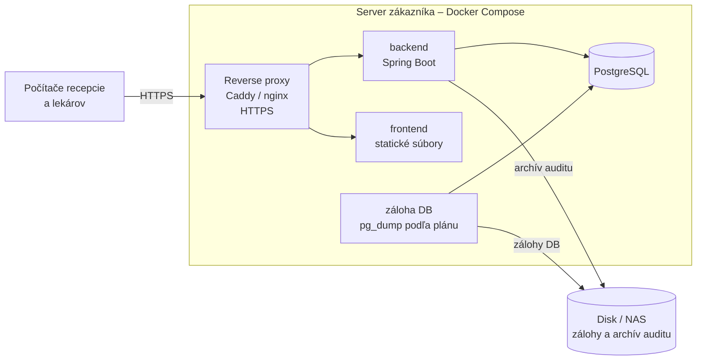

- **Jeden `docker-compose.yml`** so službami `proxy`, `backend`, `frontend`, `postgres`, `backup`. Konfigurácia cez súbor `.env` u zákazníka (heslá, adresy, cesty k archívu).
- **HTTPS** aj v internej sieti: certifikát od internej certifikačnej autority zákazníka, prípadne vlastný certifikát nainštalovaný na počítače recepcie.
- **Žiadne spojenie s internetom nie je v prevádzke potrebné.** Systém beží celý v internej sieti. (V 2. generácii pribudne len odchádzajúce spojenie na online rezervačný systém, server ani vtedy nebude z internetu dostupný.)
- **Zálohy** PostgreSQL (`pg_dump` denne, uchovávanie podľa nastavenia) a **archív auditu** sa ukladajú na disk alebo NAS zákazníka.
- **Aktualizácie:** nová verzia = nové Docker image s číslom verzie. Flyway pri štarte zmigruje databázu. Pred aktualizáciou sa automaticky spraví záloha.
- **Monitoring:** `/actuator/health` pre stav aplikácie a databázy, logy do súborov s rotáciou (bez osobných údajov).

**Rozdelenie zodpovedností (inštalácia a prevádzka robíme spolu so zákazníkom)**

| Činnosť | My (dodávateľ) | Zákazník (IT) |
|---|---|---|
| Server, operačný systém, Docker | odporúčaná konfigurácia | zabezpečí a spravuje |
| Sieť, prístup cez VPN pre podporu | – | zabezpečí |
| HTTPS certifikát | návod | vydá (interná CA) |
| Prvá inštalácia | vykoná (cez VPN alebo na mieste) | asistuje, dodá `.env` hodnoty |
| Aktualizácie | pripraví verziu, poznámky k vydaniu, vykoná alebo dodá postup | odsúhlasí termín, prípadne spustí sám |
| Zálohy | nastaví úlohu zálohovania | zabezpečí úložisko (NAS), kontroluje |
| Test obnovy zo zálohy | pripraví postup | vykoná napr. raz za štvrťrok |
| Správa používateľov | – | administrátor zákazníka |

**Doručenie verzie:** ak má server prístup na internet, stiahne Docker image z nášho registra; ak nie, verziu dodáme ako súbor (`docker save` archív) a nainštaluje sa offline. Postup inštalácie a aktualizácie bude v repozitári ako `docs/INSTALL.md`.

### 2.7 Produkt pre viac kúpeľov

Systém sa neskôr bude ponúkať aj iným kúpeľom. Keďže beží na serveri každého zákazníka, odporúčam model **jedna inštalácia = jeden zákazník** (každý má vlastnú databázu), nie spoločnú databázu pre všetkých.

| | Jedna inštalácia na zákazníka (odporúčané) | Spoločná databáza pre všetkých (multi-tenant) |
|---|---|---|
| Hodí sa na | Server u zákazníka | Prevádzku v cloude ako služba (SaaS) |
| Oddelenie dát | Úplné, každý má svoju DB | Stĺpec `organization_id` v každej tabuľke, riziko úniku medzi zákazníkmi |
| Zložitosť kódu | Nízka | Vyššia |
| Aktualizácie | U každého zvlášť | Naraz pre všetkých |

**Čo z toho vyplýva pre kód už teraz**
- Nič špecifické pre jedny kúpele nie je natvrdo v kóde: strediská, budovy, kategórie, platitelia, dôvody blokácie, roly a texty sú **dáta**, nie konštanty.
- **Profil organizácie** (`organization_profile`): názov, logo, adresa, jazyk, časové pásmo, mena. Používa sa v exportoch a hlavičkách PDF.
- **Prvotné nastavenie** novej inštalácie: administrátor, predvolené roly, prázdne číselníky; voliteľne import číselníkov zo súboru (CSV/JSON), aby sa nový zákazník nemusel klikať.
- Budúca integrácia s online rezerváciami (2. generácia) počíta s **adaptérmi**, takže každý zákazník bude môcť mať iný rezervačný systém (kap. 5.9).
- Licencia a verzia inštalácie sú viditeľné v `/actuator/info`.
- Ak by neskôr vznikla cloudová verzia, doplní sa `organization_id`; vďaka tomu, že všetky dotazy idú cez repozitáre, je to ohraničená zmena.

---

## 3. Pojmy

| Slovenský pojem | Pojem v kóde a DB | Význam |
|---|---|---|
| Stredisko | `centre` | Skupina budov s vlastnými kategóriami |
| Budova | `building` | |
| Izba | `room` | |
| Lôžko | `bed` | Konkrétne miesto na spanie v izbe, typ `REGULAR` alebo `EXTRA` |
| Prístelka | `bed.type = EXTRA` | Extra lôžko izby nad bežnú kapacitu |
| Kategória izby | `room_category` | Napr. Štandard 2L, Apartmán 4L |
| Rezervačná karta | `reservation` | Pobyt klienta (alebo viacerých osôb) od príchodu po odchod |
| Hosť | `reservation_guest` | Osoba na karte |
| Pobyt na lôžku | `stay` | Jeden pásik v pláne ubytovania: karta + lôžko + interval |
| Samostatné bývanie | `reservation.exclusive_room_use` | Klient býva sám vo viaclôžkovej izbe |
| **Držané lôžko** (pôvodne „duch“, názov potvrdený) | `HELD_BED` | Neobsadené lôžko, ktoré nemožno predať, lebo izbu užíva klient výhradne. Nie je to pobyt, len odvodený stav |
| Blokácia | `room_block` | Izba je nedostupná bez klienta (oprava, maľovanie…) |
| Kontingent / turnus | `contingent` / `contingent_turn` | Vyhradená kapacita izieb pre platiteľa v opakujúcich sa termínoch |
| Platiteľ | `payer` | Kto platí pobyt (samoplatca, poisťovňa, firma) |
| Odkladisko | – (len frontend) | Dočasné miesto pri presúvaní klientov, viď 5.4 |
| Plán ubytovania | `AccommodationPlan` (read model) | Grafický plán s pásikmi po izbách a lôžkach |
| Aktér / používateľ | `user_account` + `role` | Kto pracuje so systémom, viď kap. 8 |

### Prečo „držané lôžko“ namiesto „ducha“

V pôvodnom systéme sa voľné lôžka izby pri samostatnom bývaní zaberali fiktívnym pobytom. To spôsobuje problémy: fiktívne záznamy sa musia presúvať, skracovať a mazať spolu so skutočným pobytom, a ľahko sa rozídu.

V novom modeli:
- Pobyt má len skutočné lôžko klienta.
- Karta má príznak `exclusive_room_use = true`.
- Kontrola obsadenosti berie pri takom pobyte **celú izbu** ako obsadenú.
- Plán ubytovania zostávajúce lôžka izby zobrazí ako pásiky typu `HELD_BED`, ale v databáze žiadny taký záznam nie je.

Sťahovanie na držané lôžko (UC8) znamená zrušiť samostatné bývanie inej karty. Backend to preto vráti ako upozornenie na potvrdenie (kap. 6.3).

---

## 4. Dátový model

**Konvencie**
- Tabuľky aj stĺpce v angličtine, `snake_case`, tabuľky v jednotnom čísle.
- Primárny kľúč `id BIGINT`, cudzie kľúče `<entita>_id`.
- Dátumy pobytu typu `DATE`, časové pečiatky `TIMESTAMPTZ` (ukladané v UTC), JSON dáta `jsonb`.
- Číselníkové stavy ako textové `enum` hodnoty (`RESERVED`, `CHECKED_IN`…), nie čísla.
- Zapisovateľné tabuľky majú stĺpec `version` (optimistické zamykanie) a `created_at`, `created_by`, `updated_at`, `updated_by`. Podrobná história je v audite.
- Osobné údaje sú len v tabuľkách `client` a `reservation_guest`.

### 4.1 Ubytovacie kapacity

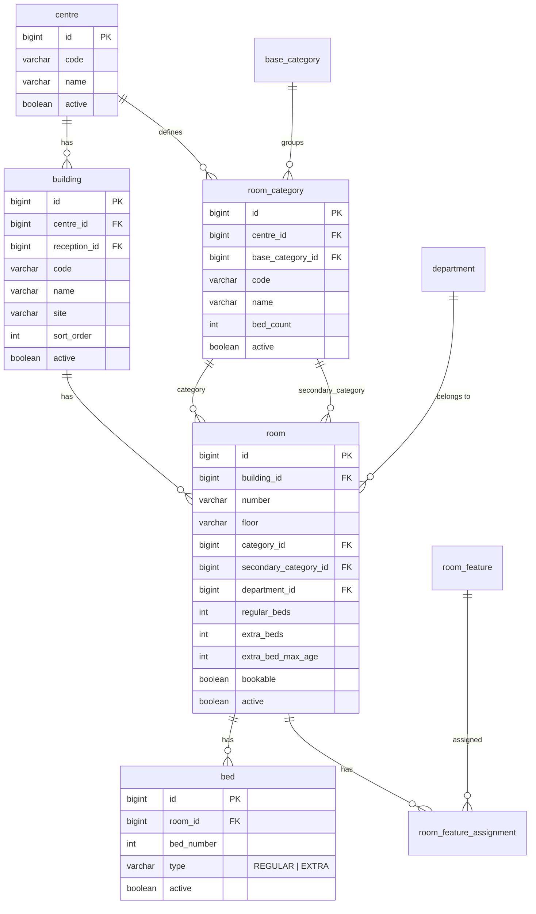

- Lôžka sú samostatné záznamy, takže prístelka je obyčajné lôžko typu `EXTRA`. Počet riadkov `bed` typu `EXTRA` zodpovedá `room.extra_beds`.
- `secondary_category_id` je vedľajšia kategória pre UC14 (jeden klient na izbe).
- `department_id` slúži na pridelenie lekára podľa izby prvej noci (UC1).
- Filtre izieb (UC17): `room_filter` (názov, vlastník alebo celá organizácia) a `room_filter_criterion` (typ izby, kategória, vlastnosť).

### 4.2 Rezervácie a pobyty

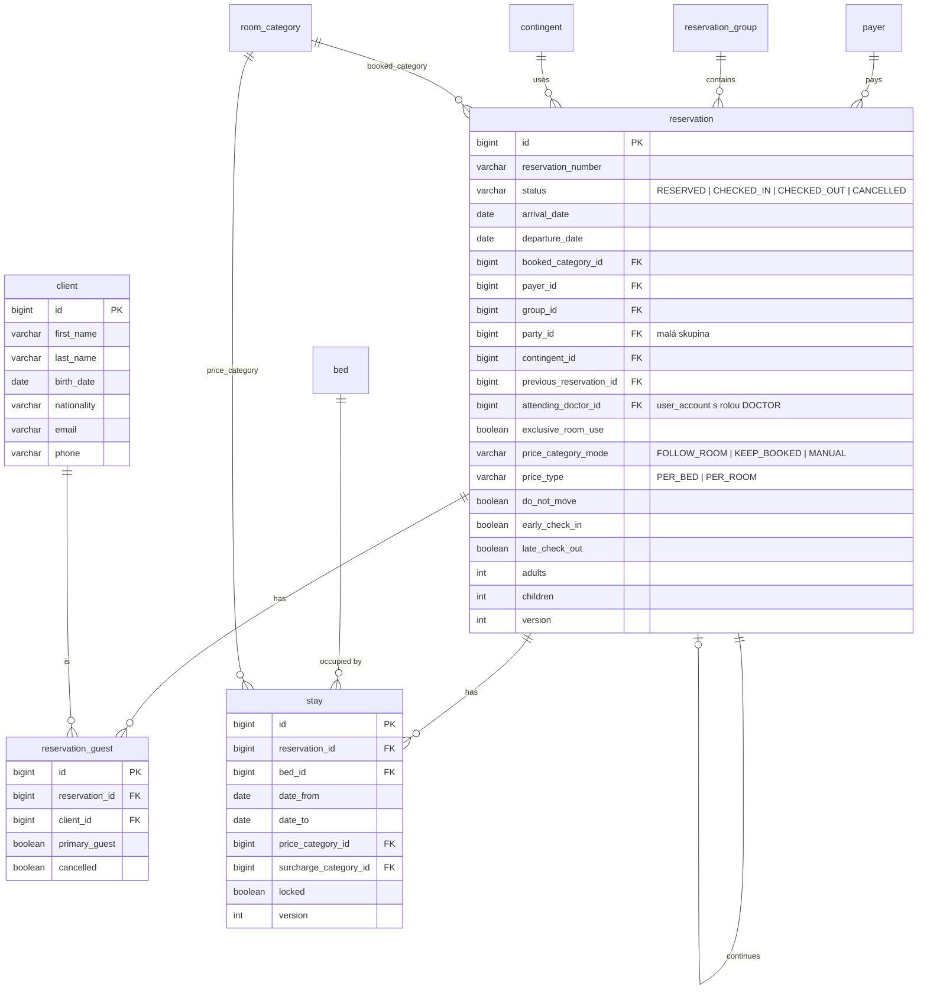

- **`stay`** je jeden pásik v pláne. Ak sa klient sťahuje uprostred pobytu, karta má viac pobytov za sebou.
- **`price_category_mode`** nahrádza kombináciu pôvodných príznakov „Zmena kategórie“ a „automatická zmena kategórie“ (kap. 5.5).
- **`previous_reservation_id`** spája nadväzujúce karty (pokračujúci pobyt).
- **`party_id`** → `reservation_party`: **malá skupina** („párty“, UC19) – napr. partneri, ktorí bývajú spolu v jednej izbe. Pri presune len jedného člena systém upozorní.
- **`locked`** na pobyte zodpovedá zámku „nepresúvať“ v pláne; **`do_not_move`** na karte platí pre všetky jej pobyty.
- **`attending_doctor_id`** odkazuje na používateľa s rolou `DOCTOR` (lekár je používateľ systému, kap. 8.5).
- Rodné číslo, adresy a čísla dokladov sa v module ubytovania nepoužívajú, takže v tomto modeli nie sú. Doplnia sa do `client` až s modulom, ktorý ich potrebuje.

### 4.3 Blokácie a kontingenty

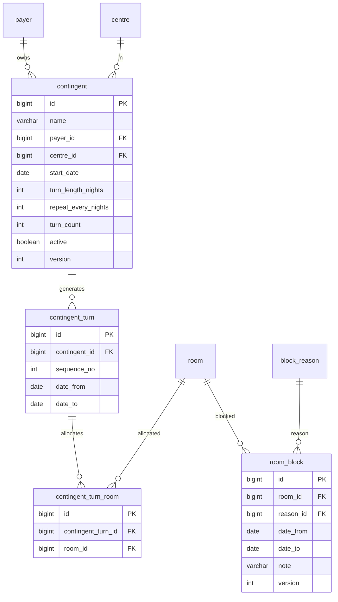

- Turnusy majú vlastné tabuľky, nie sú to blokácie. Plán ich zobrazí ako samostatný typ pásika a kontrola obsadenosti ich berie ako obsadené izby (okrem rezervácií toho istého kontingentu).
- Hlavička kontingentu sa po uložení nemení (UC23); dĺžka a opakovanie sú v nej preto pevne dané.

### 4.4 Číselníky

`payer` (samoplatca, poisťovne, firmy, typ `SELF | INSURER | COMPANY`), `block_reason`, `department`, `base_category`, `room_feature`. Pôvodné číselníky, ktoré ubytovanie nepotrebuje (typy starostlivosti, indikácie, zľavy, hybnosť…), sa neprenášajú.

### 4.5 Recepcie, obchodný deň, oznámenia a preradenie lekára

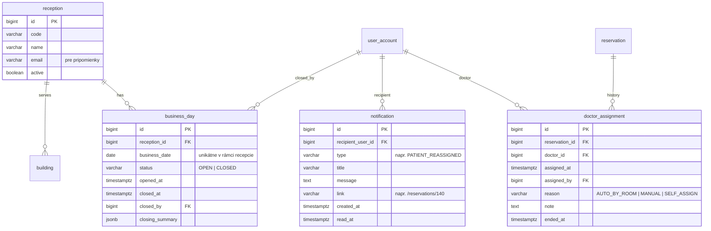

- **`reception`** – recepcia (pracovisko), ktorá spravuje skupinu budov. Každá budova patrí práve jednej recepcii (`building.reception_id`). Malé kúpele majú jednu recepciu, väčšie ich môžu mať viac (napr. hotel a vily).
- **`business_day`** – každá recepcia má vždy práve jeden otvorený obchodný deň (kap. 5.8).
- **`doctor_assignment`** – úplná história lekárov karty. Aktuálny lekár je zároveň v `reservation.attending_doctor_id` pre rýchle dotazy.
- **`notification`** – oznámenia v aplikácii (zvonček); doručujú sa naživo cez SSE (kap. 6.4).

---

## 5. Kľúčové pravidlá

### 5.1 Interval pobytu

Pobyt je polootvorený interval nocí **`[date_from, date_to)`**: `date_to` je deň odchodu. Dva intervaly kolidujú, ak `a.from < b.to && b.from < a.to`. Odchod jedného a príchod druhého v ten istý deň **nie je** kolízia. Logika je v jednej hodnotovej triede `StayPeriod`.

### 5.2 Kontrola obsadenosti

Každý zápis pobytu prejde doménovou službou `OccupancyGuard`:

1. **Lôžko je k dispozícii:** lôžko aj izba sú aktívne, izba je `bookable`, pri lôžku `EXTRA` vyhovuje vek hosťa (`extra_bed_max_age`).
2. **Bez kolízie na lôžku** s iným pobytom v intervale.
3. **Bez kolízie na izbe** s blokáciou, s turnusom kontingentu (okrem karty toho istého kontingentu) a s pobytom karty, ktorá izbu užíva výhradne (**držané lôžko**).
4. **Samostatné bývanie:** ak nová karta chce izbu výhradne, izba musí byť v intervale úplne prázdna.
5. **Nie spätne:** začiatok zmeny ≥ **aktuálny obchodný deň recepcie, ktorej patrí izba** (kap. 5.8), nie systémový dátum (UC7–UC9). Výnimka len s oprávnením `STAY_BACKDATE`.
6. **V rámci karty:** pri sťahovaní spadá deň zmeny do `[arrival_date, departure_date)` karty (UC7).
7. **Zámok:** pobyt s `locked` alebo karta s `do_not_move` vyžaduje potvrdenie a oprávnenie `STAY_MOVE_LOCKED`.
8. **Dĺžka:** ubytovanie dlhšie, ako dovoľuje oprávnenie `STAY_CREATE` s limitom nocí (UC3), sa odmietne.
9. **Iná kategória:** ubytovanie na izbu inej kategórie, než má karta, vyžaduje oprávnenie `STAY_OTHER_CATEGORY`.

Kontrola sa vykoná znovu v tej istej transakcii tesne pred zápisom. Spolu s `version` to zabráni tomu, aby dve recepčné obsadili rovnaké lôžko naraz. Poslednou poistkou je obmedzenie `EXCLUDE` v PostgreSQL (kap. 2.4): prekrývajúce sa pobyty na jednom lôžku databáza neuloží, ani keby kód zlyhal. Takú chybu backend preloží na `BED_OCCUPIED`.

### 5.3 Sťahovanie, rozdelenie a dĺžka

- **Celý pobyt (UC8):** pobyt dostane nové lôžko.
- **Časť pobytu (UC9):** pobyt sa v dni `d` rozdelí na `[from, d)` na pôvodnom lôžku a nový pobyt `[d, to)` na cieľovom lôžku.
- **Zmena dĺžky (UC10):** mení sa len koniec. Predĺženie posunie `departure_date` karty, skrátenie ho nemení.
- **Nadväzujúca karta:** ak pobyt pokračuje na inej karte, API vráti upozornenie a recepčná rozhodne, či presunúť aj pokračovanie.

### 5.4 Odkladisko a výmena

Odkladisko je **dočasný stav na frontende**. Recepčná doň presúva pásiky a backend dostane výsledok naraz ako dávku presunov:

```
POST /api/stays/moves:batch
[{ stayId, targetBedId, fromDate }, …]
```

Backend overí **konečný stav** celej dávky a zapíše ju v jednej transakcii s jedným audit záznamom, alebo nezapíše nič. Výmena dvoch klientov (UC11) je dávka s dvoma presunmi, pre pohodlie aj ako `POST /api/stays/swap`.

### 5.5 Kategória pre cenu (UC12–UC14)

`PriceCategoryResolver` určí `stay.price_category_id` pri každom zápise pobytu podľa `reservation.price_category_mode`:

| Režim | Kategória pre cenu | UC |
|---|---|---|
| `FOLLOW_ROOM` | Kategória skutočnej izby | predvolené |
| `KEEP_BOOKED` | `reservation.booked_category_id` aj po sťahovaní | UC13 |
| `MANUAL` | Ručne nastavená v „Zobraziť ubytovanie“, platí do ďalšieho sťahovania | UC12 |

Pri `price_type = PER_ROOM` a jednom klientovi na izbe sa môže použiť `room.secondary_category_id` (podľa nastavenia, UC14). `surcharge_category_id` sa vypĺňa len pre platiteľov typu `INSURER`.

### 5.6 Hromadné ubytovanie skupiny (UC5, UC6)

**Automatické (UC5)** – deterministický algoritmus:
1. Karty zoradiť: najprv samostatné bývanie, potom podľa kategórie a počtu osôb.
2. Pre každú kartu vybrať izby jej kategórie voľné v celom intervale.
3. Parametre: `onlyFullyFreeRooms`, `sameFloor`, `onePerRoom`.
4. Výsledok vrátiť najprv ako návrh (`dryRun=true`), po potvrdení zapísať v jednej transakcii.
5. Karty bez izby vrátiť v zozname `unassigned` s dôvodom.

**Ručné (UC6):** nemožno vybrať viac lôžok než osôb. Ak sa kategória izby líši, zmení sa `booked_category_id` karty.

### 5.7 Kontingenty (UC21–UC24)

- Pri založení sa z hlavičky vygenerujú turnusy (`date_from = start_date + (n-1) × repeat_every_nights`, `date_to = date_from + turn_length_nights`) a pre každý turnus vybrané izby. Dátum „do“ a počet turnusov sa prepočítavajú navzájom.
- Ak je izba v turnuse obsadená, API vráti zoznam kolízií na potvrdenie.
- Turnus možno pridať (len na dátum zodpovedajúci opakovaniu), zmazať, zmeniť jeho izby alebo presunúť na inú izbu. Skrátiť ani predĺžiť ho nemožno.

### 5.8 Obchodný deň a nočná uzávierka

„Dnešný deň“ v systéme nie je systémový dátum, ale **obchodný deň recepcie**. Mení sa až **po nočnej uzávierke**, nie o polnoci. Recepčná, ktorá o 1:00 v noci ešte ubytúva hosťa, tak pracuje stále v predchádzajúcom dni.

**Viac recepcií.** Kúpele môžu mať viac recepcií, každá spravuje svoje budovy (`building.reception_id`) a robí **vlastnú uzávierku**. Hotel teda môže mať už nový deň, kým vily ešte uzávierku nespravili.
- Pravidlá s dátumom sa riadia obchodným dňom **recepcie, ktorej patrí izba**, nie recepcie používateľa.
- Presun hosťa medzi budovami dvoch recepcií používa neskorší z ich obchodných dní (aby sa nedalo meniť spätne ani na jednej strane).
- Používateľ má predvolenú recepciu (`user_account.default_reception_id`); uzávierku smie spraviť len pre recepciu, na ktorú má oprávnenie (rozsah role, kap. 8.2).
- Kúpele s jednou recepciou to nijako nekomplikuje: majú jeden záznam `reception` a všetky budovy patria jej.

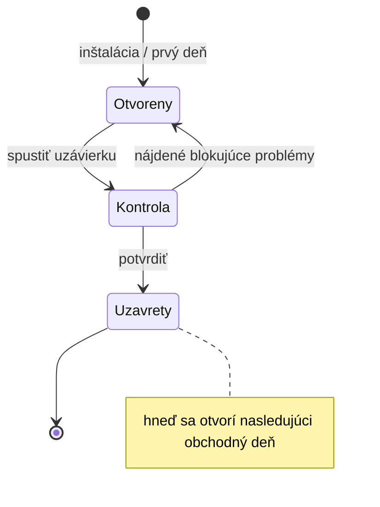

**Priebeh uzávierky** (oprávnenie `BUSINESS_DAY_CLOSE`):
1. **Kontrola** (`POST /receptions/{id}/business-day/close/preview`): vráti zoznam zistení pre budovy danej recepcie. Zistenia sú **blokujúce** alebo **len na vedomie**.
2. **Potvrdenie** (`POST /receptions/{id}/business-day/close`): v jednej transakcii s auditom sa aktuálny deň uzavrie a otvorí sa nasledujúci (`business_date + 1`). Výsledok kontroly sa uloží do `closing_summary`.
3. Používateľom, ktorí majú otvorený plán budov tejto recepcie, príde živá udalosť `business-day-changed` a frontend obnoví plán.

**Pravidlá**
- Uzávierka sa nedá vrátiť späť bežnou operáciou; oprava je možná len cez spätné zmeny s oprávnením `STAY_BACKDATE`.
- Ak sa uzávierka zabudne, deň sa **nezmení sám**. Systém po nastavenom čase (napr. o 6:00) pošle oznámenie vedúcej danej recepcie.
- Všetky pravidlá založené na dátume („nie spätne“, voľné izby od dnes, zoznam hostí pre lekára) používajú `BusinessDateProvider`, nikdy `LocalDate.now()`. V testoch sa dá nastaviť pevný deň.
**Obsah uzávierky – návrh na overenie s recepciou zákazníka**

Nasledujúci zoznam je **môj návrh** podľa bežnej praxe hotelových a kúpeľných recepcií. Čo z neho naozaj robiť, musia potvrdiť recepčné zákazníka (otvorená otázka 1). Preto bude každá kontrola samostatné pravidlo, ktoré sa dá v nastaveniach zapnúť, vypnúť a určiť, či blokuje.

| Kontrola / akcia | Typ | Predvolene |
|---|---|---|
| Hostia s odchodom dnes, ktorí nie sú odhlásení | kontrola | na vedomie |
| Rezervácie s príchodom dnes, ktoré nedorazili (*no-show*) | kontrola | na vedomie |
| Ubytovaní hostia bez pridelenej izby / lôžka | kontrola | blokuje |
| Pobyty, ktoré sa prekrývajú s blokáciou alebo turnusom | kontrola | blokuje |
| Hostia bez ošetrujúceho lekára | kontrola | na vedomie |
| Nevyriešené upozornenia a oznámenia recepcie | kontrola | na vedomie |
| Denná zostava (obsadenosť, príchody, odchody) do PDF | akcia | vypnuté |

Konfigurácia pravidiel: tabuľka `closing_rule(code, enabled, severity, reception_id NULL = všetky)`.

### 5.9 Import z online rezervačného systému – 2. generácia

**Odložené, nie je súčasťou v1.** Rezervačné karty sa vo v1 zakladajú len v tomto systéme. Zachytený je len smer riešenia, aby v1 nezatvorila dvere:

- Server je v internej sieti, preto sa **backend bude online systému pýtať** (odchádzajúce HTTPS); online systém sa na server pripájať nebude.
- Každý online systém bude mať vlastný **adaptér** na jednotný formát, takže rôzni zákazníci môžu mať rôzne systémy.
- Import vytvorí rezerváciu v stave `RESERVED` **bez pobytu**; lôžko pridelí recepcia. Konflikty pôjdu recepcii na ručné vyriešenie.
- Zápisy importu pôjdu do auditu pod technickým používateľom `integration`.

**Čo to znamená pre v1:** nič sa neimplementuje. Stačí, že `reservation` má číslo rezervácie a stav `RESERVED` bez pobytu je platný stav – oboje v návrhu už je. Do `reservation` sa v 2. generácii doplní `source` a `external_id`.

Otvorené otázky k tejto téme (ktorý online systém, obojsmerné prepojenie, overbooking) sa riešia až v 2. generácii.

---

## 6. REST API

Základná cesta `/api`. Dátumy vo formáte ISO `YYYY-MM-DD`. Zápisy vracajú aktualizované pásiky, aby frontend nemusel znova načítať celý plán. Každá odpoveď na zápis obsahuje hlavičku `X-Audit-Event-Id`.

### 6.1 Endpointy

| Metóda a cesta | Účel | UC |
|---|---|---|
| `GET /accommodation-plan?from&to&buildingIds&roomFilterId&freeOnly&fullyFree` | Plán ubytovania | UC15, UC16, UC18 |
| `GET /rooms/available?from&to&categoryId&allCategories` | Voľné izby pre kartu | UC1 |
| `GET /reservations/{id}/stays` | „Zobraziť ubytovanie“ karty | UC1, UC12 |
| `POST /reservations/{id}/stays` | Ubytovať kartu na lôžko alebo prístelku | UC1, UC2, UC4 |
| `POST /stays/with-new-reservation` | Ubytovať na voľné lôžko a založiť kartu | UC3 |
| `POST /stays/{id}/move` | Presťahovať celý pobyt alebo od dňa `fromDate` | UC7, UC8, UC9 |
| `PATCH /stays/{id}` | Zmeniť koniec pobytu, kategóriu pre cenu, zámok | UC7, UC10, UC12, UC19 |
| `DELETE /stays/{id}` | Zrušiť budúce ubytovanie | – |
| `POST /stays/moves:batch` | Dávka presunov z odkladiska | UC8, UC9, UC11 |
| `POST /stays/swap` | Výmena dvoch klientov | UC11 |
| `POST /reservation-groups/{id}/accommodate?dryRun=true` | Automatické hromadné ubytovanie | UC5 |
| `POST /reservation-groups/{id}/accommodate-manual` | Ručné hromadné ubytovanie | UC6 |
| `PUT /reservations/{id}/price-settings` | Režim kategórie, typ ceny | UC12–UC14 |
| `GET/POST/PUT/DELETE /room-filters`, `GET /room-features` | Filtre izieb | UC17 |
| `POST /room-blocks`, `PATCH/DELETE /room-blocks/{id}` | Blokácie | UC19, UC20 |
| `GET /contingents?payerId&from&to` | Zoznam kontingentov | UC21 |
| `POST /contingents/preview`, `POST /contingents` | Založiť kontingent a turnusy | UC22 |
| `POST /contingents/{id}/turns`, `DELETE /contingent-turns/{id}`, `PUT /contingent-turns/{id}/rooms` | Úprava turnusov | UC23 |
| `POST /contingent-turns/{id}/move` | Presun turnusu v pláne | UC24 |
| `GET /catalog/centres`, `/buildings`, `/rooms`, `/room-categories`, `/payers` | Číselníky | – |
| `GET /reports/guest-locations?date&centreId&buildingId&doctorId&format=json\|csv\|pdf` | Zoznam hostí s miestom ubytovania pre lekára | – |
| `GET /me` | Prihlásený používateľ, jeho roly, oprávnenia a strediská | – |
| `GET/PUT /me/preferences/{key}` | Nastavenia používateľa (farby plánu, posledné filtre) | UC16 |
| `GET /events` (SSE) | Živé udalosti: zmeny plánu, obchodný deň, oznámenia | UC15 |
| `GET /me/notifications`, `POST /me/notifications/{id}/read` | Oznámenia používateľa | – |
| `POST /reservations/{id}/doctor` | Zmeniť ošetrujúceho lekára / prevziať pacienta s poznámkou | – |
| `GET /reservations/{id}/doctor-history` | História lekárov karty | – |
| `GET /receptions`, `GET /receptions/{id}/business-day`, `POST /receptions/{id}/business-day/close/preview`, `POST /receptions/{id}/business-day/close` | Recepcie, obchodný deň a nočná uzávierka | – |
| `POST /me/password` | Zmena vlastného hesla | – |
| `GET/POST/PATCH /admin/users`, `PUT /admin/users/{id}/roles` | Správa používateľov | – |
| `POST /admin/users/{id}/reset-password`, `POST /admin/users/{id}/unlock` | Reset hesla, odomknutie účtu | – |
| `GET/POST/PATCH /admin/roles`, `PUT /admin/roles/{id}/permissions` | Správa rolí | – |
| `GET /audit/events?type&entityType&entityId&userId&from&to&operation` | Vyhľadávanie v audite (zápisy aj čítania) | – |
| `GET /audit/events/{id}` | Detail audit záznamu so zmenami | – |
| `GET /audit/clients/{clientId}/access` | Kto a kedy čítal údaje klienta (odpoveď na žiadosť podľa GDPR) | – |

### 6.2 Plán ubytovania – tvar odpovede

```json
{
  "from": "2026-11-13",
  "to": "2026-11-27",
  "rooms": [
    {
      "roomId": 1, "building": "ALF", "number": "101", "floor": "1",
      "category": { "id": 2, "code": "K2" },
      "features": ["balcony"],
      "beds": [
        { "bedId": 11, "number": 1, "type": "REGULAR" },
        { "bedId": 12, "number": 2, "type": "REGULAR" },
        { "bedId": 13, "number": 3, "type": "EXTRA" }
      ],
      "bars": [
        { "type": "STAY", "stayId": 812, "reservationId": 140, "bedId": 11,
          "from": "2026-11-10", "to": "2026-11-20", "label": "Testovský A.",
          "status": "CHECKED_IN", "locked": false, "flags": ["EARLY_CHECK_IN"] },
        { "type": "HELD_BED", "byStayId": 812, "bedId": 12,
          "from": "2026-11-10", "to": "2026-11-20" },
        { "type": "ROOM_BLOCK", "blockId": 5, "reason": "Maľovanie",
          "from": "2026-11-20", "to": "2026-11-26" },
        { "type": "CONTINGENT_TURN", "turnId": 31, "contingentId": 4,
          "payer": "Firma Demo s.r.o.", "from": "2026-11-27", "to": "2026-12-07" }
      ]
    }
  ]
}
```

Plán sa načíta **štyrmi dotazmi** (izby s lôžkami, pobyty, blokácie, turnusy v intervale) a poskladá v pamäti, bez N+1 dotazov. Cieľ: 60 izieb × 31 dní pod 300 ms. Pásiky `HELD_BED` sa dopočítajú, nie načítajú.

### 6.3 Chyby a upozornenia

- **Chyba** (HTTP 409 alebo 422, `ProblemDetail` s kódom napr. `BED_OCCUPIED`, `PAST_CHANGE`, `MISSING_PERMISSION`): zápis neprebehne.
- **Upozornenie na potvrdenie** (HTTP 409, `"confirmable": true` a zoznam `warnings`, napr. `RELEASES_HELD_BED`, `CONTINUES_ON_NEXT_RESERVATION`, `STAY_LOCKED`): frontend sa opýta a pošle požiadavku znova s `confirm=[…]`.
- Odmietnuté aj potvrdené upozornenia sa zapisujú do auditu (kap. 7.3).

### 6.4 Živé aktualizácie (SSE)

Keď recepčná zmení ubytovanie, ostatní používatelia s otvoreným plánom to **uvidia hneď**, bez tlačidla Obnoviť.

**Technika: Server-Sent Events (SSE).** Prehliadač otvorí jedno dlhé spojenie `GET /api/events` a server cez neho posiela udalosti. SSE je jednoduchšie ako WebSocket (stačí jednosmerná komunikácia server → prehliadač), funguje cez bežné HTTPS a reverse proxy a prehliadač sa po výpadku sám znova pripojí.

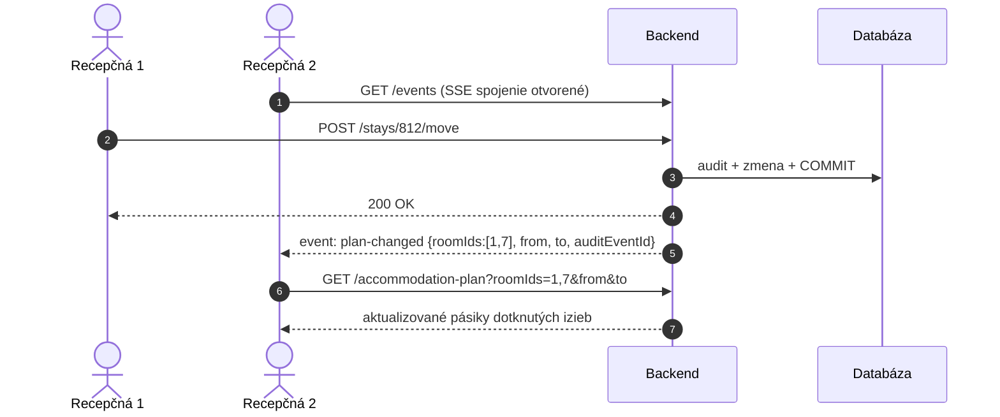

| Udalosť | Kedy | Komu |
|---|---|---|
| `plan-changed` | Zmena pobytu, blokácie alebo turnusu (po COMMIT) | Všetkým s `PLAN_VIEW` v danom stredisku |
| `business-day-changed` | Nočná uzávierka recepcie | Používateľom s plánom budov tejto recepcie |
| `notification` | Nové oznámenie (napr. preradenie pacienta, pripomienka uzávierky) | Konkrétnemu používateľovi |
| `heartbeat` | Každých 25 s | Všetkým (udržiava spojenie cez proxy) |

**Pravidlá**
- Udalosť sa odošle **až po úspešnom COMMIT** (`@TransactionalEventListener(AFTER_COMMIT)`), nikdy pri zrušenej transakcii.
- Udalosť **neobsahuje osobné údaje**, len ID izieb a rozsah dátumov. Frontend si údaje dotiahne bežným (auditovaným) volaním.
- Ak recepčná práve ťahá pásik, ktorý medzitým zmenil niekto iný, jej zápis odmietne kontrola `version` (HTTP 409) a frontend plán obnoví.
- Pri jednej inštancii backendu stačí rozosielanie v pamäti. Pri viacerých inštanciách sa udalosti medzi nimi rozošlú cez PostgreSQL `LISTEN/NOTIFY`, bez ďalšej infraštruktúry.
- Po opätovnom pripojení (`Last-Event-ID`) frontend radšej znova načíta viditeľný výsek plánu, než aby dobiehal zmeškané udalosti.

---

## 7. Audit

### 7.1 Princíp

**Každému zápisu na backende predchádza audit záznam.** Zaznamenáva, **kto**, **kedy**, **akú operáciu** urobil a **aké zmeny** spôsobila. Platí to pre všetky moduly vrátane správy používateľov, rolí a nastavení.

- Audit záznam vzniká ako **prvý krok transakcie**, ešte pred akoukoľvek zmenou dát.
- Zápis bez otvoreného audit záznamu nie je možný: ak sa entita mení mimo auditovanej operácie, backend zápis odmietne (*fail closed*).
- Audit je **len na pridávanie**. Záznamy sa nemenia; databázový používateľ aplikácie nemá na audit tabuľky práva `UPDATE` ani `DELETE`. Jediná výnimka je plánovaná úloha uchovávania (kap. 7.5), ktorá beží pod samostatným databázovým používateľom.
- Audituje sa aj **čítanie osobných údajov klienta** (kap. 7.4).

### 7.2 Model

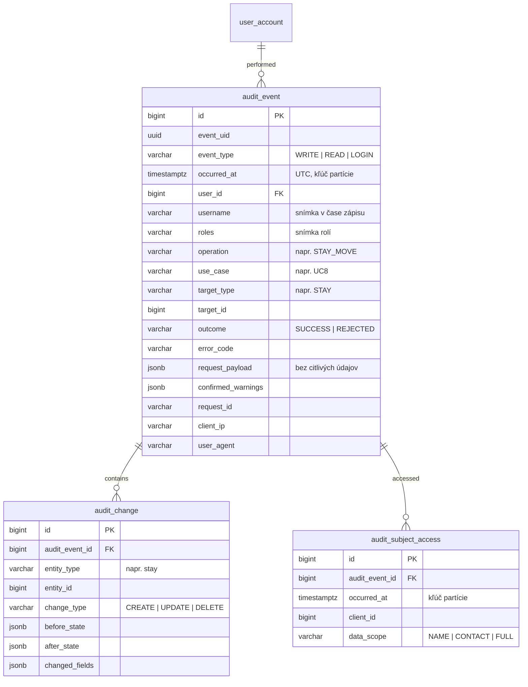

- **`audit_event`** – jedna používateľská operácia (napr. „presťahoval pobyt 812 na lôžko 45“).
- **`audit_change`** – každá zmenená entita v rámci operácie so stavom pred a po. Jedna operácia môže zmeniť viac entít (výmena dvoch klientov = dva pobyty, hromadné ubytovanie = desiatky pobytov).
- **`audit_subject_access`** – pri čítaní: ktorých klientov sa čítanie týkalo a v akom rozsahu.
- `username` a `roles` sú snímky, aby audit ostal čitateľný aj po premenovaní alebo zrušení používateľa.
- Všetky tri tabuľky sú v PostgreSQL **rozdelené na mesačné partície** podľa `occurred_at`.

### 7.3 Priebeh zápisu

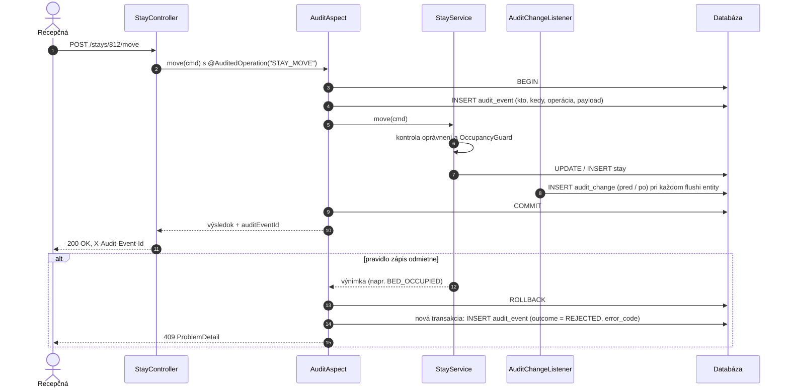

**Implementácia**
- Anotácia `@AuditedOperation(operation, useCase)` na metódach aplikačných služieb. Aspekt otvorí transakciu a ako prvý vloží `audit_event`.
- Hibernate event listener (`PostInsert`, `PostUpdate`, `PostDelete`) zapíše `audit_change` k aktuálnemu audit záznamu. Žiadna zmena entity sa tak nedá „zabudnúť“ zaznamenať.
- Ak listener zachytí zmenu bez otvoreného audit záznamu, vyhodí výnimku a transakcia sa zruší.
- Pri odmietnutí sa pôvodná transakcia zruší a do auditu sa v samostatnej transakcii zapíše záznam `REJECTED` s kódom chyby.
- Z `request_payload` a stavov entít sa vynechávajú heslá a citlivé osobné údaje.
- Audituje sa aj prihlásenie (`LOGIN`): úspešné, neúspešné a zamknutie účtu.

### 7.4 Audit čítania osobných údajov

Každá odpoveď, ktorá obsahuje osobné údaje klienta, vytvorí audit záznam typu `READ` **pred odoslaním odpovede**. Ak sa audit nepodarí zapísať, údaje sa neodošlú.

| Čo sa číta | Operácia | Rozsah (`data_scope`) |
|---|---|---|
| Plán ubytovania (skrátené mená na pásikoch) | `PLAN_VIEW` | `NAME` |
| Zoznam hostí s miestom ubytovania (lekár) | `GUEST_LOCATION_VIEW` | `NAME` |
| Rezervačná karta a jej hostia | `RESERVATION_VIEW` | `CONTACT` |
| Detail klienta | `CLIENT_VIEW` | `FULL` |
| Export (CSV, PDF) | `…_EXPORT` | podľa obsahu |

**Implementácia**
- Anotácia `@AuditedRead(operation)` na metódach, ktoré vracajú osobné údaje. Metóda vráti aj zoznam ID klientov v odpovedi a aspekt ich zapíše do `audit_subject_access` jedným hromadným `INSERT`.
- Čítania bez osobných údajov (číselníky, voľné izby, kontingenty) sa neauditujú.
- Plán ubytovania sa načítava často. Jeden záznam na jedno načítanie s ID klientov na pásikoch (bežne desiatky až stovky) PostgreSQL s partíciami zvládne bez problémov.
- Endpoint `GET /audit/clients/{clientId}/access` vráti, kto a kedy čítal údaje klienta. Je to podklad pre žiadosť dotknutej osoby podľa GDPR.

### 7.5 Uchovávanie a archivácia

| Nastavenie | Predvolená hodnota | Význam |
|---|---|---|
| `audit.retention.period` | `P6M` (6 mesiacov) | Ako dlho sú záznamy v databáze (online vyhľadateľné) |
| `audit.retention.archiveBeforeDelete` | `true` | Pred zmazaním z databázy partíciu exportovať do archívu |
| `audit.archive.retention` | `P2Y` (2 roky) | Ako dlho sa uchováva súbor archívu; potom sa natrvalo zmaže |
| `audit.retention.archiveLocation` | `/archive/audit` (zväzok na disku / NAS zákazníka) | Kam sa archív ukladá |
| `audit.retention.schedule` | `0 30 2 1 * *` | Raz mesačne v noci |

Celková doba dohľadateľnosti je teda **6 mesiacov v aplikácii + 2 roky v archíve**. Archívne súbory sú podpísané kontrolným súčtom a dajú sa v prípade potreby (kontrola, súdny spor) dočasne načítať späť do samostatnej tabuľky na prehliadanie.

- Plánovaná úloha (`@Scheduled` + ShedLock, aby bežala len raz aj pri viacerých inštanciách) každý mesiac:
  1. vytvorí partície na nasledujúce mesiace,
  2. partície staršie ako doba uchovávania exportuje do súboru (komprimovaný JSON Lines s kontrolným súčtom), ak je archivácia zapnutá,
  3. partíciu odpojí a zmaže,
  4. zmaže archívne súbory staršie ako `audit.archive.retention`.
- Samotný beh úlohy sa zapíše do auditu ako operácia používateľa `system`.
- Hodnoty sú v tabuľke nastavení a mení ich administrátor; zmena sa audituje.

> Doby 6 mesiacov a 2 roky sú predvolené hodnoty. Pri zdravotných a osobných údajoch odporúčam ich overiť so zodpovednou osobou za ochranu údajov (DPO) každého zákazníka; keďže sú konfigurovateľné, dá sa to nastaviť bez zmeny kódu.

---

## 8. Používatelia, roly a oprávnenia (aktéri)

### 8.1 Aktéri

| Aktér | Rola v systéme | Čo robí |
|---|---|---|
| Recepčná | `RECEPTIONIST` | Ubytovanie, sťahovanie, zmena dĺžky, výmena, blokácie, plán ubytovania (UC1–UC20) |
| Vedúca recepcie | `RECEPTION_MANAGER` | Všetko ako recepčná + kontingenty, spätné zmeny, presun zamknutých pobytov, organizačné filtre izieb |
| Lekár | `DOCTOR` | Zoznam hostí s miestom ubytovania (kap. 8.5); je priraďovaný ku kartám ako ošetrujúci lekár |
| Administrátor | `ADMIN` | Zakladá používateľov a spravuje roly, číselníky a nastavenia. Nemusí mať práva na ubytovanie |
| Audítor | `AUDITOR` | Len čítanie audit záznamov |
| Systém | `SYSTEM` (technický používateľ `system`) | Plánované úlohy (archivácia auditu, pripomienka uzávierky). Aj jeho zápisy idú do auditu |

Konkrétne roly a ich oprávnenia sa nastavujú v databáze; tabuľka hore je predvolená sada pri inštalácii.

### 8.2 Model

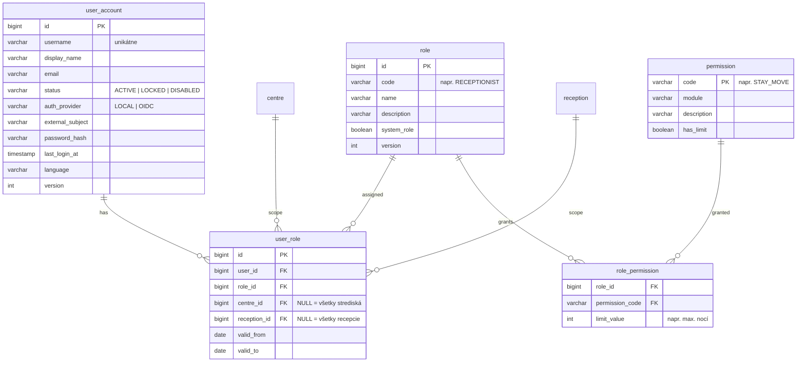

- **Oprávnenie** je jemná jednotka (`STAY_MOVE`), **rola** je pomenovaná sada oprávnení. Kód kontroluje len oprávnenia, nikdy názvy rolí.
- **`limit_value`** pokrýva parametrické práva. Pri `STAY_CREATE` je to maximálny počet nocí jedného ubytovania, rozsah 1–365. Hodnota **365 znamená bez obmedzenia** (dlhší pobyt sa v kúpeľoch nepredpokladá). Ak má používateľ viac rolí, platí najvyšší limit.
- **`centre_id`** a **`reception_id`** v `user_role` obmedzujú rolu na stredisko alebo recepciu: recepčná hlavnej budovy nemusí meniť ubytovanie vo vilách ani robiť ich uzávierku. `NULL` znamená bez obmedzenia.
- **`valid_from` / `valid_to`** umožňujú dočasné pridelenie (zastupovanie).
- Zmeny používateľov, rolí a ich pridelení sa auditujú rovnako ako ostatné zápisy.

### 8.3 Oprávnenia

| Kód | Popis | Limit | UC | Predvolene |
|---|---|---|---|---|
| `PLAN_VIEW` | Zobraziť plán ubytovania a karty | – | UC15–UC18 | REC, MGR |
| `STAY_CREATE` | Ubytovať klienta | max. nocí (1–365, 365 = bez obmedzenia) | UC1–UC6 | REC (365), MGR (365) |
| `STAY_OTHER_CATEGORY` | Ubytovať na inú kategóriu, než má karta | – | UC1, UC13 | REC, MGR |
| `STAY_MOVE` | Sťahovať, meniť dĺžku, vymieňať | – | UC7–UC11 | REC, MGR |
| `STAY_MOVE_LOCKED` | Presunúť zamknutý pobyt | – | UC8, UC19 | MGR |
| `STAY_BACKDATE` | Meniť ubytovanie spätne | – | UC7–UC10 | MGR |
| `PRICE_CATEGORY_EDIT` | Meniť kategóriu pre cenu a typ ceny | – | UC12–UC14 | REC, MGR |
| `ROOM_BLOCK_EDIT` | Vytvárať a mazať blokácie | – | UC19, UC20 | REC, MGR |
| `ROOM_FILTER_EDIT` | Spravovať filtre izieb pre celú organizáciu | – | UC17 | MGR |
| `CONTINGENT_VIEW` / `CONTINGENT_EDIT` | Kontingenty a turnusy | – | UC21–UC24 | REC / MGR |
| `GUEST_LOCATION_VIEW` | Zoznam hostí s miestom ubytovania | – | – | DOCTOR, REC, MGR |
| `GUEST_LOCATION_VIEW_ALL` | Zoznam všetkých hostí, nielen vlastných pacientov | – | – | MGR |
| `GUEST_LOCATION_EXPORT` | Export zoznamu do CSV/PDF | – | – | DOCTOR, MGR |
| `PATIENT_SELF_ASSIGN` | Lekár si prevezme pacienta iného lekára (s poznámkou) | – | – | DOCTOR |
| `DOCTOR_ASSIGN` | Priradiť ľubovoľného lekára ku karte | – | UC1 | REC, MGR |
| `RESERVATION_VIEW` / `RESERVATION_EDIT` | Zobraziť / zakladať a meniť rezervačné karty | – | – | REC, MGR |
| `CLIENT_VIEW` | Detail klienta s kontaktnými údajmi | – | – | REC, MGR |
| `BUSINESS_DAY_CLOSE` | Nočná uzávierka | – | – | REC, MGR |
| `CATALOG_EDIT` | Číselníky izieb, lôžok, kategórií | – | – | ADMIN |
| `USER_ADMIN` | Správa používateľov a rolí | – | – | ADMIN |
| `SETTINGS_EDIT` | Systémové nastavenia | – | – | ADMIN |
| `AUDIT_VIEW` | Čítanie auditu | – | – | AUDITOR, ADMIN |

Kontrola oprávnení je v aplikačnej vrstve (`@PreAuthorize` alebo vlastná `PermissionChecker` služba), vrátane rozsahu na stredisko, ktorému patrí izba. Vlastné nastavenia (farby plánu) si mení každý používateľ sám, bez osobitného oprávnenia.

### 8.4 Lokálne účty a prihlásenie

- Používateľov **zakladá výhradne administrátor** (`USER_ADMIN`). Samoregistrácia nie je.
- Pri založení alebo resete hesla systém vygeneruje **jednorazové heslo**, ktoré si používateľ pri prvom prihlásení musí zmeniť (`must_change_password`).
- Heslá sa ukladajú ako hash **Argon2id** (alebo BCrypt), nikdy v čitateľnej podobe.
- Po N neúspešných pokusoch sa účet zamkne (`status = LOCKED`) a odomkne ho administrátor alebo po uplynutí času.
- Prihlásenie vytvorí reláciu so serverovým session cookie (`HttpOnly`, `Secure`, `SameSite=Strict`) a CSRF ochranou; relácia vyprší po nečinnosti.
- **Prvý administrátor** vznikne pri prvom štarte z premenných prostredia (`APP_BOOTSTRAP_ADMIN_USERNAME`, jednorazové heslo vypísané do logu alebo zadané cez premennú). Po vytvorení sa bootstrap už nespustí.
- Používateľ sa nemaže, len deaktivuje (`DISABLED`), aby audit a priradenia lekárov ku kartám zostali platné.
- Model ostáva pripravený na neskoršie napojenie na firemné prihlásenie (OIDC): `auth_provider`, `external_subject`.

Doplnené stĺpce `user_account`: `must_change_password`, `failed_login_count`, `locked_until`, `password_changed_at`, `default_reception_id`.

### 8.5 Lekár a zoznam hostí s miestom ubytovania

Lekár je **používateľ s rolou `DOCTOR`**. Ku karte ho priraďuje `reservation.attending_doctor_id` (ručne alebo automaticky podľa izby prvej noci, UC1); každá zmena sa uloží do histórie `doctor_assignment`.

**Lekár vidí len svojich pacientov.** Ak nastane chyba v priradení (napr. pacient je u iného lekára omylom), lekár si ho môže **prevziať**:

1. Vyhľadá pacienta podľa mena alebo čísla karty (`GET /reservations/search?q=…&scope=transfer`). Výsledok obsahuje len meno, rok narodenia, izbu a aktuálneho lekára; vyhľadanie sa audituje ako čítanie.
2. Potvrdí prevzatie s **povinnou poznámkou** (dôvod), `POST /reservations/{id}/doctor` s `reason = SELF_ASSIGN`.
3. Systém v jednej transakcii s auditom:
   - ukončí predchádzajúce priradenie (`ended_at`) a vytvorí nové,
   - zmení `reservation.attending_doctor_id`,
   - vytvorí **oznámenie pôvodnému lekárovi** („Pacienta X prevzal MUDr. Y, dôvod: …“) a voliteľne aj vedúcej recepcie,
   - pošle živú udalosť `notification`.
4. Pôvodný lekár oznámenie uvidí hneď (zvonček v aplikácii); pri vypnutom počítači pri najbližšom prihlásení.

**E-mailové oznámenia** sú voliteľné a zapínajú sa začiarkavacím políčkom na dvoch úrovniach:
- **Administrátor** v systémových nastaveniach zapne e-maily (`notifications.email.enabled`) a zadá poštový server zákazníka (SMTP). Kým nie je zapnuté, políčko sa používateľom nezobrazuje.
- **Každý používateľ** si v profile začiarkne „Posielať oznámenia aj e-mailom“ (`notifications.email`), prípadne zvlášť podľa typu oznámenia.

Oznámenie v aplikácii vznikne vždy; e-mail je doplnkový kanál. E-mail neobsahuje osobné údaje pacienta, len text „Máte nové oznámenie“ a odkaz do aplikácie, keďže e-mail nie je dostatočne chránený kanál pre zdravotné údaje.

Pre lekára je hlavný výstup **zoznam hostí a ich miesto ubytovania** k zvolenému dňu:

`GET /api/reports/guest-locations?date=2026-11-14&centreId&buildingId&doctorId&format=json|csv|pdf`

| Stĺpec | Zdroj |
|---|---|
| Meno a priezvisko hosťa | `client` |
| Rok narodenia (na rozlíšenie rovnakých mien) | `client.birth_date` |
| Budova, poschodie, izba, lôžko (prístelka) | `stay` → `bed` → `room` → `building` |
| Príchod – odchod | `reservation` |
| Stav karty | `reservation.status` |
| Ošetrujúci lekár | `reservation.attending_doctor_id` |
| Zmena izby počas dňa | ak má karta v ten deň dva pobyty, uvedú sa oba s dátumom presunu |

- Lekár vidí len **svojich pacientov** (`attending_doctor_id = ja`); všetkých hostí len s oprávnením `GUEST_LOCATION_VIEW_ALL` (predvolene vedúca recepcie, nie lekár).
- Zoznam obsahuje hostí, ktorí v daný deň bývajú alebo prichádzajú (stav `RESERVED` alebo `CHECKED_IN`).
- Každé zobrazenie aj export sa zapíše do auditu čítania (kap. 7.4).

---

## 9. Nastavenia

Nastavenia sú na dvoch úrovniach; zmeny oboch sa auditujú.

**Systémové nastavenia** – tabuľka `app_setting(key, value, value_type, description, version)`, mení ich administrátor:

| Kľúč | Význam | Predvolene | UC |
|---|---|---|---|
| `accommodation.plan.allowFromReservation` | Ubytovať klienta z karty v pláne ubytovania | `true` | UC2 |
| `accommodation.doctorByFirstNight` | Doplniť lekára podľa izby prvej noci | `true` | UC1 |
| `pricing.priceCategoryDefaultMode` | Predvolený režim kategórie pre cenu (`FOLLOW_ROOM` / `KEEP_BOOKED`) | `FOLLOW_ROOM` | UC12, UC13 |
| `pricing.singleOccupancySecondaryCategory` | Pri jednom klientovi na izbe použiť vedľajšiu kategóriu | `false` | UC14 |
| `audit.retention.*` | Uchovávanie auditu | viď kap. 7.5 | – |
| `security.login.maxFailedAttempts` | Počet neúspešných prihlásení do zamknutia | `5` | – |
| `security.session.idleTimeout` | Odhlásenie po nečinnosti | `PT30M` | – |
| `businessDay.closeReminderAt` | Kedy pripomenúť zabudnutú nočnú uzávierku | `06:00` | – |
| `notifications.email.enabled` | E-mailové oznámenia sú k dispozícii (začiarkavacie políčko) | `false` | – |
| `notifications.email.smtp*` | Poštový server zákazníka (heslo v `.env`) | – | – |
| `doctor.reassign.notifyManager` | Pri prevzatí pacienta upozorniť aj vedúcu recepcie | `false` | – |
| `organization.timezone` | Časové pásmo inštalácie | `Europe/Bratislava` | – |

**Nastavenia používateľa** – tabuľka `user_preference(user_id, key, value jsonb, version)`, mení si ich každý sám:

| Kľúč | Význam | UC |
|---|---|---|
| `plan.colors` | Farby pásikov podľa typu a stavu | UC16 |
| `plan.defaultView` | Predvolené budovy, rozsah dní, filter izieb | UC16, UC17 |
| `plan.showExtraBeds`, `plan.showHolidays` | Zobrazenie prístelok a sviatkov | UC16 |
| `notifications.email` | Začiarkavacie políčko „Posielať oznámenia aj e-mailom“ (aj podľa typu oznámenia) | – |
| `reception.default` | Predvolená recepcia používateľa | – |

Ak používateľ vlastnú hodnotu nemá, použije sa systémová predvolená hodnota.

Pre testy je v `application.yml` navyše `app.business-date`, pevný obchodný deň.

---

## 10. Testovanie

| Úroveň | Čo | Nástroj |
|---|---|---|
| Unit | `StayPeriod`, `OccupancyGuard` (vrátane držaných lôžok a extra lôžok), `PriceCategoryResolver`, hromadné ubytovanie, generovanie turnusov, výpočet limitov oprávnení | JUnit 5 |
| Integračné | Repozitáre, Flyway schéma, `EXCLUDE` obmedzenia, partície auditu | `@DataJpaTest` + Testcontainers (PostgreSQL) |
| API | Každý use case UC1–UC24 aspoň jedným scenárom (úspech + hlavné odmietnutie) | `@SpringBootTest` + MockMvc |
| Audit | Každý zápisový endpoint vytvorí `audit_event` a `audit_change`; odmietnutý zápis vytvorí `REJECTED`; zápis mimo auditu zlyhá; každý endpoint s osobnými údajmi vytvorí `READ` záznam so zoznamom klientov; audit nejde zmeniť ani zmazať; úloha uchovávania archivuje a zmaže len staré partície | integračné testy |
| Prihlásenie | Zamknutie po N pokusoch, vynútená zmena jednorazového hesla, bootstrap prvého administrátora | integračné testy |
| Obchodný deň | Uzávierka posunie deň len svojej recepcii; pravidlo „nie spätne“ sa riadi obchodným dňom recepcie izby; vypnuté pravidlo uzávierky sa nekontroluje | integračné testy |
| Živé udalosti | Po COMMIT príde `plan-changed`, po ROLLBACK nič; udalosť neobsahuje osobné údaje | integračné testy (SSE klient) |
| Lekár | Lekár nevidí cudzích pacientov; prevzatie bez poznámky sa odmietne; pôvodný lekár dostane oznámenie | API testy |
| Oprávnenia | Každý zápisový endpoint bez oprávnenia vráti 403; rozsah na stredisko | `@WithMockUser` / vlastné test fixtures |
| Architektúra | Doména nezávisí od Springu/JPA, moduly nevolajú cudzie `infrastructure` | ArchUnit / Spring Modulith |
| Súbeh | Dve paralelné ubytovania na to isté lôžko: jedno uspeje, druhé dostane 409 | integračný test |

Demo a testovacie dáta sú **len fiktívne**: žiadne skutočné mená, adresy, kontakty, rodné čísla ani čísla dokladov (OP, pas). Ak je údaj potrebný, použije sa zjavne vymyslená hodnota (napr. „Ukážková 1, 000 00 Demovo“, doklad `XX000000`, e-mail `@example.invalid`). Pravidlo platí pre demo dáta, testovacie fixtures, príklady v dokumentácii aj snímky obrazovky.

---

## 11. Mapovanie z pôvodnej databázy (len na vysvetlenie)

Pôvodná databáza ISZP sa **nepoužíva ako model**. Tabuľka slúži na pochopenie pojmov a pre voliteľný jednorazový import demo dát.

| Pôvodná tabuľka / stĺpec | Nový model | Poznámka |
|---|---|---|
| `STREDISKA` | `centre` | |
| `BUDOVY`, `LOKALITY` | `building` (`site`) | lokalita je len atribút budovy |
| `POKOJE` | `room` | `LUZEK` → `regular_beds`, `PRISTYLEK` → `extra_beds`, `KATEGP` → `secondary_category_id` |
| lôžko (`OBSAZENE.POSTEL`) | `bed` | lôžka sú samostatné záznamy |
| `KATEGOR`, `ZAKLKAT` | `room_category`, `base_category` | |
| `KARTY` (~300 stĺpcov) | `reservation` (+ `client`) | prenáša sa len to, čo potrebuje ubytovanie |
| `STAVKARTY` 1 / 4 / 5 / -1 | `RESERVED` / `CHECKED_IN` / `CHECKED_OUT` / `CANCELLED` | odvodené z dát |
| `BYDLISAM` | `exclusive_room_use` | |
| `ZMENA_KATEGORIE` + automatická zmena | `price_category_mode` | |
| `NESTEHOVAT` | `do_not_move` | |
| `OSOBY_REZ_KARTA`, `KARTY_JMENA_KLIENTU` | `reservation_guest`, `client` | |
| `KARTA_SKUPINY_HLAVICKA` | `reservation_group` | |
| `KARTY_PARTNERI` | `reservation.party_id` (`reservation_party`) | dvojice kariet s rovnakými dátumami v jednej izbe, teda malá skupina, nie nadväzujúci pobyt |
| `OBSAZENE` | `stay` | `FIXNI` → `locked`, `KATEGORIE` → `price_category_id` |
| `OBSAZENE.DUCH_IDP` („duch“) | – | nahradené držaným lôžkom (kap. 3) |
| `OBSAZENE.PRISTYLKA` | `bed.type = EXTRA` | |
| `BLOKACE_POKOJE` | `room_block` | |
| kontingent (v demo DB chýba), `BLOKACE_POKOJE.ID_KONTINGENT` | `contingent`, `contingent_turn`, `contingent_turn_room` | vlastné tabuľky |
| `POBOCKY` | `payer` | |
| `ODDELENI` | `department` | |
| `KDO_ZALOZIL`, `KDY_ZMENIL`… | `created_by`, `updated_at`… + `audit_event` | |

**Zistenia v demo dátach**: chýba tabuľka kontingentov, nie sú tam žiadne prístelky ani „duchovia“, jedna blokácia (izba 52) sa prekrýva s pobytom a karty obsahujú rodné čísla. Prevedené demo dáta pre prototyp sú v `prototyp/demo-data/` (bez rodných čísel, bez kolíznej blokácie).

---

## 12. Rozhodnutia a otvorené otázky

### 12.1 Rozhodnuté (14. 11. 2026)

| # | Otázka | Rozhodnutie | Kde v dokumente |
|---|---|---|---|
| 1 | Databáza | PostgreSQL vo všetkých prostrediach; Elasticsearch ani Protocol Buffers nie sú potrebné | 2.4 |
| 2 | Prihlásenie | Lokálne účty, zakladá ich administrátor | 8.4 |
| 3 | Názov „duch“ | **Držané lôžko** (`HELD_BED`) | 3 |
| 4 | Audit čítania osobných údajov | Áno | 7.4 |
| 5 | Uchovávanie auditu | Konfigurovateľné: 6 mesiacov v databáze, potom archív | 7.5 |
| 6 | Limit nocí | Číslo pri role, 1–365, 365 = bez obmedzenia | 8.2, 8.3 |
| 7 | Lekár | Rola `DOCTOR`; výstup zoznam hostí s miestom ubytovania | 8.5 |
| 8 | Farby plánu | Na používateľa | 9 |
| 9 | Kde systém beží | Server zákazníka v internej sieti, Docker Compose | 2.6 |
| 10 | Docker | Áno, pre vývoj, testy aj nasadenie | 2.2, 2.6 |
| 11 | Viac kúpeľov | Áno, neskôr; odporúčaná jedna inštalácia na zákazníka | 2.7 |
| 12 | Koho pacientov vidí lekár | Len svojich; môže si pacienta prevziať s poznámkou, pôvodný lekár dostane oznámenie | 8.5 |
| 13 | Archív auditu | 2 roky (konfigurovateľne), potom zmazať | 7.5 |
| 14 | Zmena „dnešného dňa“ | Po nočnej uzávierke recepcie | 5.8 |
| 15 | Živé zmeny v pláne | Áno, cez SSE | 6.4 |
| 16 | Import z online rezervačného systému | Áno, ale až v **2. generácii**; vo v1 sa nerieši | 5.9 |
| 17 | Viac recepcií | Návrh s tým počíta: každá recepcia má svoje budovy, obchodný deň a uzávierku | 4.5, 5.8 |
| 18 | Inštalácia a aktualizácie | Spolupráca dodávateľa a IT zákazníka | 2.6 |
| 19 | E-mailové oznámenia | Voliteľné, zapína administrátor a každý používateľ začiarkavacím políčkom | 8.5, 9 |

### 12.2 Otvorené otázky

**Na overenie s recepciou zákazníka**
1. **Obsah nočnej uzávierky:** ktoré kontroly z návrhu v kap. 5.8 recepcia naozaj potrebuje, ktoré majú blokovať a či chýba niečo, čo dnes robí ručne (napr. tlač zostavy, odovzdanie pokladne)?
2. **Koľko recepcií** majú prví zákazníci a ktoré budovy patria ku ktorej recepcii?

**Lekár**
3. Ako sa pri UC1 určuje lekár **automaticky podľa izby**? Návrh: oddelenie má priradených lekárov (`department_doctor`) a vyberie sa ten s najmenším počtom pacientov. Alebo vždy ručne?
4. V akej forme lekár zoznam potrebuje: obrazovka, **tlač / PDF**, CSV? Má obsahovať aj iné údaje (diéta, hybnosť, poznámka)?

**Osobné údaje**
5. Ako dlho sa uchovávajú **údaje klientov** po odchode a má systém vedieť klienta **anonymizovať** (právo na vymazanie podľa GDPR)?

**Prihlásenie**
6. Pravidlá hesiel: minimálna dĺžka, platnosť (napr. zmena každých 90 dní), zákaz opakovania starých hesiel?
7. Je potrebné **dvojfaktorové overenie**, aspoň pre administrátora?
8. Môže byť jeden používateľ prihlásený **na viacerých počítačoch naraz**?

**Produkt a prevádzka**
9. **Jazyky rozhrania:** stačí slovenčina, alebo aj čeština, angličtina, nemčina?
10. Bude mať server zákazníka **prístup na internet** k nášmu registru Docker image, alebo budeme verzie dodávať ako súbor?

**Rozsah**
11. Rátať s **check-inom a check-outom** (zmena stavu karty) v tomto module, alebo ich robí iná časť systému?
12. Aký je **objem**: počet izieb, súčasne pracujúcich používateľov a pobytov ročne?

---

## 13. Postup implementácie (návrh tiketov)

Podrobné tikety **prvého prototypu** (P01–P12) sú v `prototyp/tickets/`, prehľad a poradie v `prototyp/README.md`.

| # | Tiket | Výsledok |
|---|---|---|
| 1 | Kostra backendu: Spring Boot, PostgreSQL cez Docker Compose, Testcontainers, Flyway `V1` s novou schémou, `ProblemDetail` | Aplikácia štartuje, `/actuator/health` |
| 2 | Modul `iam`: používatelia, roly, oprávnenia, lokálne prihlásenie, bootstrap administrátora, `GET /me`, seed predvolených rolí | Prihlásený používateľ s oprávneniami |
| 3 | Modul `audit`: `@AuditedOperation`, listener zmien, fail-closed kontrola, `REJECTED` záznamy, audit prihlásenia, partície, ochrana proti zmene | Každý zápis je auditovaný |
| 3b | Audit čítania: `@AuditedRead`, `audit_subject_access`, `GET /audit/clients/{id}/access` | Každé čítanie osobných údajov je auditované |
| 4 | Modul `catalog` a demo dáta (voliteľne import z pôvodnej DB) | Číselníky a izby s lôžkami |
| 5 | `StayPeriod` + `OccupancyGuard` s unit testami | Jadro pravidiel vrátane držaných a extra lôžok |
| 6 | Plán ubytovania + voľné izby | UC15, UC16, UC18 |
| 7 | Ubytovanie z karty a z plánu | UC1–UC4 |
| 8 | Sťahovanie, zmena dĺžky, dávka presunov, výmena | UC7–UC11, UC19 |
| 9 | `PriceCategoryResolver` | UC12–UC14 |
| 10 | Blokácie a filtre izieb | UC17, UC20 |
| 11 | Hromadné ubytovanie skupiny | UC5, UC6 |
| 12 | Kontingenty a turnusy | UC21–UC24 |
| 13 | Správa používateľov a rolí, reset hesla, vyhľadávanie v audite | admin API |
| 14 | Zoznam hostí s miestom ubytovania pre lekára (JSON, CSV, PDF) | výstup pre rolu `DOCTOR` |
| 15 | Nastavenia používateľa (farby a predvolený pohľad plánu) | UC16 |
| 16 | Uchovávanie auditu: plánovaná úloha, archivácia (2 roky), mazanie partícií a starých archívov | kap. 7.5 |
| 17 | Recepcie, obchodný deň a nočná uzávierka s konfigurovateľnými pravidlami; `BusinessDateProvider` v celom systéme | kap. 5.8 |
| 18 | Živé udalosti (SSE) a oznámenia | kap. 6.4 |
| 19 | Lekár: prevzatie pacienta, história priradení, oznámenie pôvodnému lekárovi | kap. 8.5 |
| 20 | Nasadenie: Docker image, `docker-compose.yml` pre zákazníka, reverse proxy s HTTPS, zálohy, `docs/INSTALL.md`, offline doručenie verzie | kap. 2.6 |
| 21 | E-mailové oznámenia: SMTP, systémový prepínač, začiarkavacie políčko používateľa | kap. 8.5, 9 |

Audit a oprávnenia (tikety 2, 3 a 3b) sú zámerne pred prvým zápisom aj čítaním dát, aby každý ďalší modul vznikal už s nimi. Tiket 17 (obchodný deň) odporúčam spraviť pred tiketom 7, lebo pravidlo „nie spätne“ ho potrebuje.
