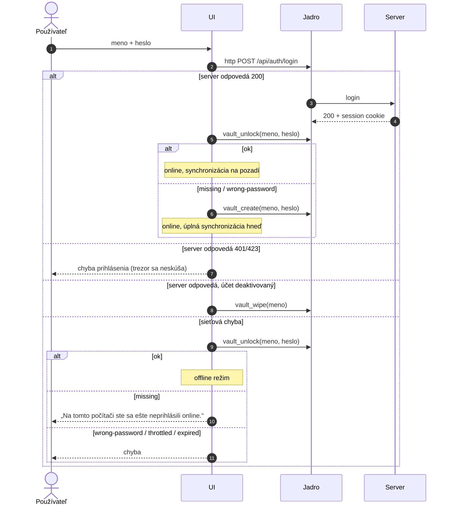

# Detailed design – frontend TheraSuite

| | |
|---|---|
| **Stav** | Návrh v1, na pripomienkovanie |
| **Dátum** | 17. 11. 2026 |
| **Nadväzuje na** | `docs/frontend/HLD-frontend.md`, `docs/HLD-ubytovanie.md` |

Kapitoly sú písané tak, aby sa na ne dalo odkazovať z tiketov (`DLD kap. X`).

---

## 1. Štruktúra repozitára

```
frontend/
  package.json, vite.config.ts, tsconfig.json, eslint.config.js, vitest.config.ts
  index.html
  src/
    main.tsx
    app/                    # skladanie aplikácie
      App.tsx, router.tsx, providers.tsx
      layout/AppShell.tsx   # menu, lišta spojenia, recepcia + obchodný deň
    features/
      auth/                 # prihlásenie, odomknutie, zmena hesla, zamknutie
      plan/                 # mriežka plánu, bočný panel, odkladisko
      stays/                # ubytovanie, presun, dĺžka, výmena (dialógy a mutácie)
      reservations/         # vyhľadávanie a detail karty
      movements/            # príchody a odchody
      business-day/         # nočná uzávierka
      guest-list/           # zoznam hostí pre lekára
      admin/                # používatelia
      audit/                # vyhľadávanie v audite
      offline/              # stav spojenia, lišta, denník čítaní
      updates/              # kontrola verzie a aktualizácia
    shared/
      api/                  # JEDINÉ miesto volaní servera
        schema.d.ts         # generované z OpenAPI (npm run api:gen), commituje sa
        client.ts           # typované volania nad Platform.http
        errors.ts           # ApiError, ProblemDetail, upozornenia na potvrdenie
        queryKeys.ts
      platform/             # rozhranie k natívnemu jadru
        types.ts            # interface Platform
        tauri.ts            # implementácia cez @tauri-apps/api (invoke, listen)
        web.ts              # implementácia pre vývoj a testy (fetch, EventSource, trezor v pamäti)
        index.ts            # výber implementácie
      offline/              # synchronizácia, dátové sady, stav spojenia
      ui/                   # spoločné komponenty
      i18n/sk.json
      time/                 # práca s dátumami (LocalDate ako string 'YYYY-MM-DD')
  src-tauri/
    Cargo.toml              # workspace: app + crates/vault
    tauri.conf.json
    capabilities/default.json
    src/
      main.rs, lib.rs
      net/http.rs           # reqwest + cookie jar + CSRF + overenie certifikátu cez Windows
      net/sse.rs            # SSE klient, udalosti do UI
      config.rs             # adresa servera, %ProgramData% a %APPDATA%
      commands.rs           # Tauri príkazy (kap. 3)
    crates/vault/           # šifrovaný trezor, BEZ závislosti na Tauri (kap. 4)
```

**Pravidlá**
- Komponenty nevolajú `Platform` ani `fetch` priamo. Server len cez `shared/api`, trezor len cez `shared/offline`.
- Funkcia (`features/x`) môže použiť `shared/*`, ale nie inú funkciu. Výnimka: `app/` skladá všetko. Kontroluje to ESLint (`import/no-restricted-paths`).
- Dátumy z API sú stringy `YYYY-MM-DD` a v kóde sa tak aj držia (žiadne `Date` pre kalendárne dni, aby nevznikali posuny časového pásma). Pomocné funkcie sú v `shared/time`.

**Skripty `package.json`:** `dev` (Vite, web režim s proxy na `localhost:8080`), `build`, `lint`, `test`, `api:gen` (z `http://localhost:8080/v3/api-docs` profilu `local`), `tauri:dev`, `tauri:build`.

---

## 2. Rozhranie `Platform`

```ts
// shared/platform/types.ts
export interface HttpRequest {
  method: 'GET' | 'POST' | 'PUT' | 'PATCH' | 'DELETE';
  path: string;                       // vždy začína /api/ alebo /actuator/
  query?: Record<string, string | number | boolean | string[] | undefined>;
  body?: unknown;                     // JSON
  headers?: Record<string, string>;   // napr. If-None-Match
  accept?: 'json' | 'bytes';          // bytes pre CSV/PDF
  timeoutMs?: number;                 // predvolene 15 000
}
export interface HttpResponse {
  status: number;
  headers: Record<string, string>;    // malé písmená
  json?: unknown;
  bytes?: Uint8Array;
}
export type NetError = { kind: 'network' | 'timeout' | 'tls' | 'config'; message: string };

export type LiveState = 'connecting' | 'open' | 'closed';
export interface LiveEvent { type: 'plan-changed' | 'business-day-changed' | 'notification' | 'heartbeat'; data: unknown; id?: string }

export interface Vault {
  exists(username: string): Promise<boolean>;
  create(username: string, password: string): Promise<void>;   // zmaže starý, ak existuje
  unlock(username: string, password: string): Promise<'ok' | 'wrong-password' | 'expired' | 'missing'>;
  rewrap(oldPassword: string, newPassword: string): Promise<void>;
  lock(): Promise<void>;
  wipe(username: string): Promise<void>;
  put(dataset: string, key: string, value: unknown, meta?: EntryMeta): Promise<void>;
  get<T>(dataset: string, key: string): Promise<{ value: T; meta: EntryMeta } | null>;
  list(dataset: string): Promise<string[]>;
  remove(dataset: string, keys: string[]): Promise<void>;
  info(): Promise<{ username: string; lastFullSyncAt?: string; sizeBytes: number } | null>;
}
export interface EntryMeta { etag?: string; syncedAt: string /* ISO */ }

export interface Platform {
  kind: 'tauri' | 'web';
  http(req: HttpRequest): Promise<HttpResponse>;            // vyhodí NetError pri sieťovej chybe
  live: {
    connect(onEvent: (e: LiveEvent) => void, onState: (s: LiveState) => void): () => void;
  };
  vault: Vault;
  config: { serverUrl(): Promise<string | null>; setServerUrl(url: string): Promise<void>; deviceId(): Promise<string> };
  app: {
    version(): Promise<string>;
    checkUpdate(): Promise<{ version: string; notes?: string } | null>;
    installUpdate(onProgress: (pct: number) => void): Promise<void>;  // po inštalácii reštart
  };
  files: { save(defaultName: string, bytes: Uint8Array, filters: { name: string; extensions: string[] }[]): Promise<boolean> };
}
```

- `tauri.ts` mapuje metódy na príkazy z kap. 3 (`invoke`) a udalosti (`listen`).
- `web.ts`: `http` cez `fetch` s `credentials: 'include'` a CSRF hlavičkou z `document.cookie` (Vite proxy na rovnakom pôvode, takže cookie funguje), `live` cez `EventSource`, `vault` v pamäti (heslo sa overí len porovnaním pri `create`), `app.checkUpdate` vždy `null`.
- Výber: `'__TAURI_INTERNALS__' in window ? tauri : web`.

---

## 3. Natívne jadro (Rust)

### 3.1 Príkazy

| Príkaz | Vstup | Výstup | Poznámka |
|---|---|---|---|
| `http_request` | `HttpRequest` | `HttpResponse` / chyba `NetError` | kap. 3.2 |
| `live_connect` / `live_disconnect` | – | – | udalosti `live://event`, `live://state` |
| `vault_exists`, `vault_create`, `vault_unlock`, `vault_rewrap`, `vault_lock`, `vault_wipe` | podľa `Vault` | | kap. 4 |
| `vault_put`, `vault_get`, `vault_list`, `vault_remove`, `vault_info` | | | len pri odomknutom trezore, inak chyba `locked` |
| `config_get`, `config_set_server_url`, `config_device_id` | | | kap. 3.3 |
| `app_version`, `update_check`, `update_install` | | | `tauri-plugin-updater` |
| `file_save` | názov, bajty, filtre | `bool` | `tauri-plugin-dialog` + zápis |

`capabilities/default.json` povolí len tieto príkazy a pluginy `dialog`, `updater`, `process` (reštart). Žiadny `shell`, `fs` ani `http` plugin pre JS.

### 3.2 HTTP a SSE

- `reqwest` s `rustls` a `rustls-platform-verifier` (certifikáty z úložiska Windows), `cookie_store` v pamäti procesu (relácia sa po zatvorení aplikácie stratí, ako v prehliadači).
- URL = `serverUrl` + `path`; iná cesta než `/api/**`, `/actuator/health` alebo `/updates/**` → chyba `config`.
- Pri `POST/PUT/PATCH/DELETE` jadro doplní `X-XSRF-TOKEN` z cookie `XSRF-TOKEN` pre adresu servera. Ak cookie ešte nie je, najprv urobí `GET /api/me` (backend ju pošle cez `CsrfCookieFilter`).
- `serverUrl` musí byť `https://`; `http://` len v debug builde.
- SSE: jedno spojenie `GET /api/events`, parsovanie `event:`/`data:`/`id:`, opätovné pripojenie s oneskorením 1, 2, 5, 10, 30 s. Po 401 sa nepripája a pošle stav `closed` s dôvodom `unauthorized`.
- Logy (`tauri-plugin-log`, súbor s rotáciou v `%LOCALAPPDATA%\TheraSuite\logs`): metóda, cesta **bez query**, status, trvanie. Nikdy telo odpovede.

### 3.3 Konfigurácia

Poradie: `%APPDATA%\TheraSuite\config.json` (nastavil používateľ) → `%ProgramData%\TheraSuite\config.json` (nastavilo IT) → nič = obrazovka „Adresa servera“.

```json
{ "serverUrl": "https://therasuite.kupele.local", "deviceName": "Recepcia-1" }
```

`deviceId` = náhodné UUID vygenerované pri prvom spustení, uložené v `%APPDATA%`. Posiela sa v denníku offline čítaní (kap. 7).

---

## 4. Trezor (crate `vault`)

### 4.1 Súbory

```
%LOCALAPPDATA%\TheraSuite\vaults\<hex(sha256(serverUrl + "\n" + username.lower()))>\
  vault.db      # SQLite
```

```sql
CREATE TABLE header (
  id INTEGER PRIMARY KEY CHECK (id = 1),
  format_version INTEGER NOT NULL,      -- 1
  username TEXT NOT NULL,
  kdf_salt BLOB NOT NULL,               -- 16 B
  kdf_m_kib INTEGER NOT NULL,           -- 65536
  kdf_t INTEGER NOT NULL,               -- 3
  kdf_p INTEGER NOT NULL,               -- 1
  dek_nonce BLOB NOT NULL,              -- 12 B
  dek_wrapped BLOB NOT NULL,            -- AES-256-GCM(KEK, DEK)
  created_at TEXT NOT NULL,
  last_full_sync_at TEXT,
  failed_unlocks INTEGER NOT NULL DEFAULT 0,
  next_unlock_after TEXT
);
CREATE TABLE entry (
  dataset TEXT NOT NULL,
  key TEXT NOT NULL,
  nonce BLOB NOT NULL,                  -- 12 B, nový pri každom zápise
  ciphertext BLOB NOT NULL,             -- AES-256-GCM(DEK, json), AAD = dataset || 0x00 || key
  etag TEXT,
  synced_at TEXT NOT NULL,
  PRIMARY KEY (dataset, key)
);
```

- `dataset` a `key` sú nešifrované, preto **nesmú obsahovať osobné údaje** (len ID a dátumy, kap. 5.1).
- KEK = Argon2id(heslo, `kdf_salt`, m=64 MiB, t=3, p=1), 32 B. DEK = 32 náhodných bajtov.
- DEK žije len v pamäti jadra (`zeroize` pri `lock`). Do JS sa nikdy neposiela.
- Zápis v transakcii; SQLite `journal_mode=WAL`.

### 4.2 Operácie

| Operácia | Správanie |
|---|---|
| `create` | Zmaže existujúci priečinok, vytvorí nový header, nastaví DEK do pamäti (odomknuté). |
| `unlock` | Ak `next_unlock_after` > teraz → chyba `throttled` s časom. Odvodí KEK, rozbalí DEK. Úspech: vynuluje `failed_unlocks`. Neúspech: `failed_unlocks + 1`, po 5. pokuse čakanie 30 s, potom 1, 2, 5, 15 min (ďalej 15 min). Ak `offline.maxAgeDays` je nastavené a `last_full_sync_at` je staršie → priečinok zmaže, vráti `expired`. |
| `rewrap` | Overí staré heslo, zabalí ten istý DEK pod KEK z nového hesla a nového saltu. Dáta sa neprešifrovávajú. |
| `wipe` | Zmaže priečinok používateľa. |

`maxAgeDays` sa ukladá do headeru pri každej synchronizácii z `client-config`, aby platilo aj offline.

### 4.3 Testy crate

Vytvorenie a odomknutie; zlé heslo; `rewrap` (staré heslo prestane platiť, dáta ostanú); AAD (prehodenie `key` medzi záznamami → chyba dešifrovania); obmedzenie pokusov; `expired`; v súbore sa nenachádza otvorený text (test hľadá známy reťazec v bajtoch `vault.db`).

---

## 5. Offline dáta a synchronizácia

### 5.1 Dátové sady

| `dataset` | `key` | Obsah | Oprávnenie | Zdroj |
|---|---|---|---|---|
| `session` | `me`, `client-config` | `MeView`, `ClientConfig` | – | `/api/me`, `/api/client-config` |
| `catalog` | `centres`, `receptions`, `buildings`, `rooms`, `room-categories`, `payers` | zoznamy | – | `/api/catalog/*` |
| `business-day` | `<receptionId>` | `BusinessDayView` | `PLAN_VIEW` | `/api/receptions/{id}/business-day` |
| `plan` | `<receptionId>` | `{ from, to, plan }` | `PLAN_VIEW` | `/api/accommodation-plan?receptionId&from&to` |
| `reservation` | `<reservationId>` | detail karty s hosťami | `RESERVATION_VIEW` | B03 |
| `movements` | `<receptionId>:<date>` | príchody a odchody | `PLAN_VIEW` | B02 |
| `guest-list` | `<date>` | riadky zoznamu | `GUEST_LOCATION_VIEW` | B05 |
| `preferences` | `<prefKey>` | hodnota | – | B06 |
| `journal` | `<uuid>` | záznam denníka čítaní | – | kap. 7 |

Recepcie, ktoré sa synchronizujú = recepcie v rozsahu `PLAN_VIEW` z `MeView.permissions[].scopes` (`receptionId = null` znamená všetky).

### 5.2 Okno plánu

`from = businessDate(recepcia) − offline.planDaysBack` (predvolene 1), `to = businessDate + offline.planDaysAhead` (predvolene 14). Hodnoty prichádzajú v `client-config`.

### 5.3 `SyncEngine` (shared/offline/syncEngine.ts)

```ts
interface SyncEngine {
  fullSync(reason: 'login' | 'reconnect' | 'business-day' | 'manual'): Promise<SyncReport>;
  syncRooms(receptionId: number, roomIds: number[], from: string, to: string): Promise<void>;
  periodicCheck(): Promise<void>;
  status(): SyncStatus;   // lastFullSyncAt, running, lastError
}
```

**Úplná synchronizácia** (postupne, max. 3 paralelné požiadavky):
1. `client-config`, `me` (pri 401 → stav `session-expired`, koniec).
2. Číselníky (s ETag).
3. Pre každú recepciu: obchodný deň → plán v okne (s ETag) → príchody a odchody pre `businessDate` a `businessDate+1` → karty B03 pre recepciu a okno (s ETag).
4. Zoznam hostí pre `businessDate` hlavnej recepcie používateľa.
5. Upratovanie: zmaže záznamy `reservation`, ktoré už nie sú v žiadnom pláne ani v príchodoch; zmaže `movements` a `guest-list` so starším dátumom.
6. `vault.header.last_full_sync_at = now`.
7. Invalidácia všetkých TanStack Query dotazov (UI sa prekreslí).

Pri `304` sa obsah nemení, aktualizuje sa len `synced_at`. Chyba jednej sady nezastaví ostatné; `SyncReport` ich vymenuje a lišta ukáže „Časť údajov sa nepodarilo obnoviť“.

**Čiastočná** po `plan-changed { receptionId, roomIds, from, to }`: ak sa prekrýva s oknom, `GET /api/accommodation-plan?roomIds…` a nahradenie týchto izieb v uloženom pláne; potom B03 `?ids=` pre karty na týchto izbách a obnova príchodov a odchodov danej recepcie.

**Po `business-day-changed`:** úplná synchronizácia tejto recepcie (okno sa posunie).

**Pravidelná kontrola:** každých `offline.syncIntervalSec` (300) s náhodným posunom ±30 s, len ak `online`.

**Štart po prihlásení / reconnecte:** oneskorenie náhodne 0–30 s (ak trezor už má dáta; inak hneď).

### 5.4 Čítanie dát v UI

```ts
// shared/offline/offlineQuery.ts
function offlineQuery<T>(ds: string, key: string, fetcher: (etag?: string) => Promise<{ status: 200 | 304; data?: T; etag?: string }>)
```

- `online`: zavolá `fetcher` s uloženým ETagom. `200` → uloží do trezoru, vráti dáta. `304` → vráti dáta z trezoru a zapíše zobrazenie do denníka (kap. 7). Sieťová chyba → prepne stav na `checking` a vráti dáta z trezoru.
- `offline` / `session-expired`: dáta z trezoru + zápis do denníka.
- Výsledok nesie `source: 'server' | 'cache'` a `syncedAt`; komponent `<DataAge>` ho ukáže.
- Ak v trezore nič nie je: stav prázdnej obrazovky „Tieto údaje nie sú na tomto počítači uložené“.

Dotazy, ktoré nie sú v tabuľke 5.1 (admin, audit, voľné izby), idú len online. Offline ukážu „Dostupné len online“.

---

## 6. Stav spojenia

```ts
type ConnState = 'online' | 'checking' | 'offline' | 'session-expired' | 'locked';
```

| Udalosť | Prechod |
|---|---|
| SSE `open` alebo úspešná HTTP odpoveď | → `online` |
| Žiadny `heartbeat` 40 s, SSE `closed`, sieťová chyba požiadavky | → `checking`: `GET /actuator/health` (timeout 3 s), 2 pokusy po 5 s |
| `checking` zlyhá | → `offline`; ďalej kontrola každých 15 s |
| Kontrola v `offline` uspeje | `GET /api/me`: 200 → `online` + úplná synchronizácia + odoslanie denníka; 401 → `session-expired` |
| 401 z hocijakej požiadavky | → `session-expired`: dialóg s heslom nad aktuálnou obrazovkou (dáta ostávajú viditeľné z trezoru) |
| Nečinnosť `idleTimeoutSec` (myš/klávesnica) | → `locked`: `vault.lock()`, obrazovka zamknutia; odomknutie heslom: online → `POST /api/auth/login`, offline → `vault.unlock` |

Hook `useConnection()` vracia stav a `canWrite = state === 'online'`. Každé tlačidlo, ktoré zapisuje, používa `<WriteAction>` (je neaktívne s tooltipom „Nedostupné bez spojenia so serverom“).

---

## 7. Denník čítaní (audit offline)

Záznam pri každom zobrazení osobných údajov **z trezoru** (offline alebo pri `304`):

```json
{
  "uid": "1f6c…",                    // UUID, idempotencia
  "occurredAt": "2026-11-17T22:51:03+01:00",
  "username": "recepcna.hlavna",
  "deviceId": "8c2e…",
  "operation": "RESERVATION_VIEW",  // PLAN_VIEW | RESERVATION_VIEW | GUEST_LOCATION_VIEW | MOVEMENTS_VIEW | GUEST_LOCATION_EXPORT
  "dataScope": "CONTACT",           // NAME | CONTACT
  "clientIds": [140, 141],
  "connection": "OFFLINE"           // OFFLINE | CACHED
}
```

- Ten istý pohľad s tými istými klientmi sa v rámci 5 minút nezapisuje znova (obnovenie plánu by inak zahltilo denník).
- Odoslanie: po prechode do `online` a potom každú minútu, dávky po max. 500 → `POST /api/audit/offline-reads`; pri `2xx` sa záznamy z trezoru zmažú. Server ignoruje už prijaté `uid`.
- Pri `wipe` (deaktivovaný účet, expirácia `maxAgeDays`) sa neodoslaný denník zmaže spolu s trezorom. Je to známe obmedzenie; pred vymazaním na žiadosť používateľa sa aplikácia pokúsi denník odoslať, ak je online.

---

## 8. Chyby z API

```ts
// shared/api/errors.ts
class ApiError extends Error {
  status: number;
  code?: string;              // ProblemDetail "code", napr. BED_OCCUPIED
  title?: string; detail?: string;
  confirmable: boolean;       // HLD-ubytovanie 6.3
  warnings: string[];         // RELEASES_HELD_BED, …
  fieldViolations: { field: string; message: string }[];
}
```

| Prípad | Správanie UI |
|---|---|
| 409 `confirmable` | `<ConfirmWarningsDialog>` so slovenským textom ku každému kódu; „Pokračovať“ pošle tú istú požiadavku s `confirm=[…]` |
| 409 konflikt verzie / obsadené lôžko | upozornenie, obnovenie dotknutých izieb, mutácia sa nezopakuje |
| 422 s `fieldViolations` | chyby pri poliach formulára |
| 403 | „Na túto akciu nemáte oprávnenie.“ |
| 401 | stav `session-expired` (kap. 6) |
| 5xx | všeobecná chyba s kódom `X-Audit-Event-Id`, ak je v odpovedi |
| `NetError` | stav `checking`; čítanie z trezoru; zápis sa **nezopakuje automaticky** |

Texty ku kódom chýb a upozornení sú v `sk.json` pod `errors.<CODE>`; neznámy kód zobrazí `title` z ProblemDetail.

---

## 9. Plán ubytovania

### 9.1 Model pre zobrazenie

```ts
interface PlanVM {
  from: string; to: string; days: string[];             // ISO dátumy
  businessDates: Record<number, string>;                // receptionId → obchodný deň
  rows: PlanRow[];                                       // ploché pre virtualizáciu
}
type PlanRow =
  | { kind: 'room'; roomId: number; label: string; building: string; category: string; receptionId: number }
  | { kind: 'bed'; roomId: number; bedId: number; bedLabel: string; extra: boolean; bars: BarVM[] };
interface BarVM {
  id: string;                                            // 'stay:812', 'held:812:12', 'block:5'
  type: 'STAY' | 'HELD_BED' | 'ROOM_BLOCK';
  bedId: number | null;                                  // ROOM_BLOCK = celá izba
  from: string; to: string;                              // skutočné dátumy (aj mimo okna)
  startCol: number; endCol: number;                      // orezané na okno
  label?: string; status?: string; locked?: boolean; flags?: string[];
  stayId?: number; reservationId?: number; partyId?: number;
}
```

`buildPlanVM(planResponse, filters, preferences)` je čistá funkcia s unit testami (orezanie na okno, blokácia cez všetky lôžka izby, prázdna izba, extra lôžko).

### 9.2 Vykreslenie

- Mriežka: ľavý stĺpec (budova / izba / lôžko) a hlavička dní sú prilepené (`position: sticky`); riadky virtualizované (`@tanstack/react-virtual`), stĺpce nie (max. 62 dní).
- Šírka dňa podľa zoomu: 24 / 36 / 56 px. Pásik pobytu ide **od polovice dňa príchodu po polovicu dňa odchodu** (príchod popoludní, odchod doobeda), takže odchod a príchod na tom istom lôžku sa nezrážajú.
- Zvýraznené: víkendy, obchodný deň recepcie (zvislá čiara), dni mimo lokálnych dát (šrafovanie a text „Údaje nie sú k dispozícii“).
- Farby: `preferences['plan.colors']`, inak predvolené podľa `status` (`RESERVED`, `CHECKED_IN`, `CHECKED_OUT`), držané lôžko šrafované, blokácia sivá.
- Cieľ výkonu: 200 izieb × 31 dní, prvé vykreslenie do 500 ms, ťahanie plynulé (bez prekresľovania celej mriežky; pásiky sú `memo` a pozícia ťahaného prvku ide cez `transform`).

### 9.3 Interakcie (len `online` a s oprávnením)

| Akcia | Gesto | Volanie |
|---|---|---|
| Detail | klik na pásik | bočný panel: pobyt + karta (offline z trezoru) |
| Ubytovať z plánu | klik na voľné lôžko a deň → dialóg výberu karty | `POST /api/reservations/{id}/stays` |
| Presun celého pobytu | ťahanie pásika na iné lôžko | `POST /api/stays/{id}/move` |
| Presun od dňa | ťahanie s klávesom Alt (od dňa pod kurzorom) alebo kontextové menu „Presťahovať od…“ | `POST /api/stays/{id}/move` s `fromDate` |
| Zmena konca | ťahanie pravého okraja | `PATCH /api/stays/{id}` |
| Výmena | kontextové menu „Vymeniť s…“, potom klik na druhý pásik | `POST /api/stays/swap` |
| Odkladisko | ťahanie do panela odkladiska; z neho späť na lôžka; „Uložiť zmeny“ | `POST /api/stays/moves:batch` |
| Zrušiť budúce ubytovanie | kontextové menu | `DELETE /api/stays/{id}` |

- Počas ťahania sa podľa lokálnych dát vyznačí, či je cieľ voľný (len pomoc, rozhoduje server).
- Po úspechu: odpoveď obsahuje aktualizované pásiky (HLD-ubytovanie kap. 6) → nahradia sa v cache dotknuté izby; vlastná SSE udalosť s rovnakým `auditEventId` sa ignoruje.
- Odkladisko je len stav UI (Zustand store v `features/plan`), zahodí sa pri odchode z obrazovky s potvrdením. Pri strate spojenia ostáva, ale tlačidlo „Uložiť“ je neaktívne.

### 9.4 Filtre a nastavenia

Recepcia (predvolená z `MeView.defaultReceptionId`), budovy, rozsah dní (predvolene obchodný deň −1 až +13), `freeOnly`, `fullyFree`, `occupiedOnly` (len izby s pobytom v rozsahu; vylučuje sa s `fullyFree`, s `freeOnly` dáva obsadené izby s voľným riadnym lôžkom), zoom. Posledné filtre sa ukladajú do `plan.defaultView` (B06), offline len lokálne.

---

## 10. Ostatné obrazovky

| Obrazovka | Online | Offline | Poznámky |
|---|---|---|---|
| Prihlásenie | `POST /api/auth/login` → `vault` (kap. 11) | `vault.unlock` | pole „Server“ len ak nie je nakonfigurovaný |
| Zmena hesla | `POST /api/me/password` → `vault.rewrap` | – | povinná pri `mustChangePassword` |
| Rezervačné karty | hľadanie `GET /api/reservations?q…`, detail `GET /api/reservations/{id}` | hľadanie v kartách v trezore (meno, číslo karty) – lokálne, normalizované bez diakritiky | detail ukazuje kontakty len pri `RESERVATION_VIEW` |
| Príchody a odchody | B02 | z trezoru | dva stĺpce, prepínač dnes / zajtra, klik → detail karty |
| Nočná uzávierka | `preview` → zoznam zistení (blokujúce červeno) → `close` s potvrdením | neaktívne | po úspechu úplná synchronizácia recepcie |
| Zoznam hostí pre lekára | B05 JSON; CSV z B05; tlač z HTML | z trezoru; tlač a CSV z lokálnych dát (zapíše `GUEST_LOCATION_EXPORT` do denníka) | lekár vidí len svojich pacientov – filtruje server |
| Používatelia | `GET/POST/PATCH /api/admin/users`, `PUT …/roles`, `reset-password`, `unlock`; roly z B07 | – | jednorazové heslo po založení/resete sa zobrazí raz s tlačidlom Kopírovať |
| Audit | `GET /api/audit/events`, `/{id}`, `/api/audit/clients/{id}/access` | – | stránkovanie na serveri, filtre v URL |
| Môj profil | heslo, verzia, server, „Odhlásiť a vymazať údaje z tohto počítača“ | vymazanie funguje aj offline | |

---

## 11. Prihlásenie – priebeh



Pri `mustChangePassword` sa po prihlásení otvorí len zmena hesla; trezor sa vytvorí až s novým heslom.

---

## 12. Aktualizácie

- `tauri.conf.json` → `plugins.updater.endpoints = ["{{serverUrl}}/updates/latest.json"]` (adresa sa dopĺňa za behu z konfigurácie), `pubkey` = verejný kľúč aktualizácií. Súkromný kľúč nie je v repozitári (tajomstvo CI).
- Kontrola pri štarte a každú hodinu, len `online`.
- `GET /api/client-config` (B01): ak `app.version < minClientVersion` → blokujúca obrazovka „Je potrebná aktualizácia“ s tlačidlom Aktualizovať; inak len nenápadné upozornenie „Je k dispozícii nová verzia“.
- Inštalácia: MSI v režime `passive`, potom reštart aplikácie. Trezor ostáva; ak sa zmení `format_version`, migruje ho nová verzia.

---

## 13. Konfigurácia (`client-config`, B01)

```json
{
  "apiVersion": "1.0",
  "minClientVersion": "0.1.0",
  "serverTime": "2026-11-17T23:40:00+01:00",
  "idleTimeoutSec": 1800,
  "offline": {
    "planDaysBack": 1,
    "planDaysAhead": 14,
    "syncIntervalSec": 300,
    "maxAgeDays": null
  }
}
```

Hodnoty `offline.*` sú v `application.yml` (`app.client.*`); keď vznikne systémová tabuľka nastavení (HLD-ubytovanie kap. 9), presunú sa tam.

---

## 14. Testovací scenár offline (ručný, pred vydaním)

1. Prihlásiť sa ako recepčná online, počkať na „Synchronizované“.
2. Zastaviť backend (`docker compose stop backend`). Do 60 s sa objaví lišta Offline; plán, karta, príchody aj zoznam hostí sa dajú prezerať; tlačidlá zápisu sú neaktívne.
3. Zatvoriť aplikáciu a reštartovať PC. Prihlásiť sa tým istým heslom → offline režim s rovnakými dátami. Iným menom, ktoré sa na PC neprihlásilo → hláška „ešte ste sa neprihlásili online“.
4. Zlé heslo 5× → čakanie.
5. Spustiť backend. Do 30 s → dialóg na heslo (relácia vypršala) → online, dáta sa obnovia, v audite pribudnú čítania s označením `OFFLINE`.
6. V druhej aplikácii presunúť pobyt → zmena sa v prvej objaví do 2 s.
7. Admin deaktivuje účet → pri ďalšom prihlásení online sa trezor zmaže.
8. V priečinku trezoru vyhľadať priezvisko demo hosťa ako text → nenájde sa.
