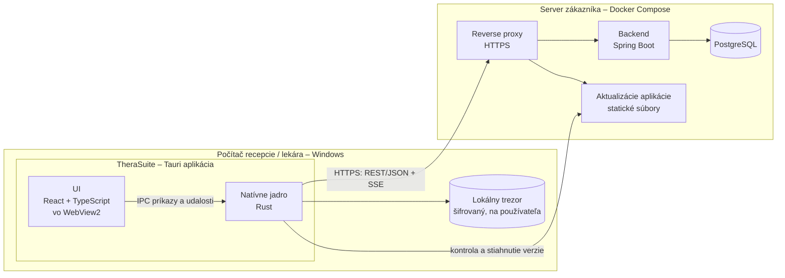
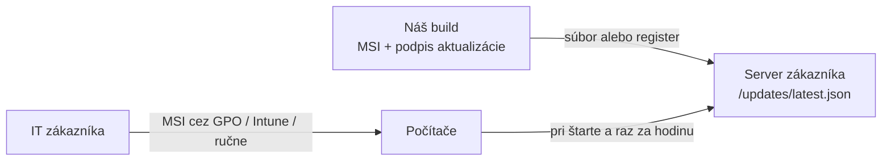
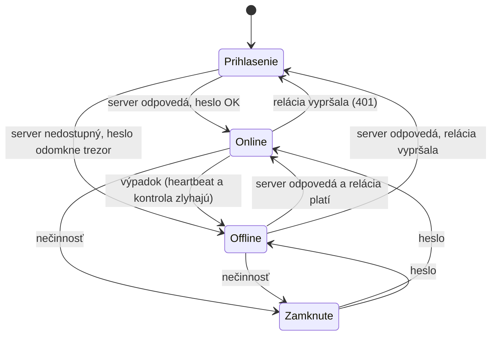
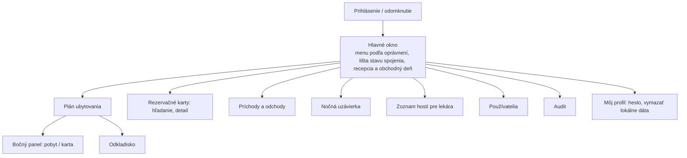

# High-level design – frontend TheraSuite (desktopová aplikácia s offline režimom)

| | |
|---|---|
| **Stav** | Návrh v1, na pripomienkovanie |
| **Dátum** | 17. 11. 2026 |
| **Nadväzuje na** | `docs/HLD-ubytovanie.md` (v4) – backend, API, audit, oprávnenia |
| **Detailný návrh** | `docs/frontend/DLD-frontend.md` |
| **Tikety** | `docs/frontend/README.md`, `docs/frontend/tickets/` |

**Vstupné rozhodnutia (17. 11. 2026)**
- Frontend je **desktopová aplikácia (Tauri)** inštalovaná na počítačoch recepcie a lekárov, nie web v prehliadači.
- Očakávaná záťaž: **80–200 aktívnych používateľov** naraz.
- Pri výpadku spojenia so serverom musí aplikácia **ďalej zobrazovať dáta**, ale nezapisuje. Počas výpadku má byť vidieť: **plán ubytovania, zoznam hostí pre lekára, detail rezervačnej karty, príchody a odchody**.
- Dáta sú offline dostupné **neobmedzene dlho**, aj po reštarte počítača.
- Rozsah prvej verzie: **rozsah prototypu** (prihlásenie, plán, ubytovanie, sťahovanie / dĺžka / výmena, živé zmeny, nočná uzávierka) + **zoznam hostí pre lekára** + **administrácia používateľov** + **audit**.

---

## 1. Cieľ a rozsah

Frontend dáva recepčným, vedúcim recepcie, lekárom, administrátorom a audítorom grafické rozhranie nad REST API backendu ubytovania. Hlavnou obrazovkou je **plán ubytovania** (izby a lôžka × dni, pásiky pobytov), v ktorom recepčná ubytúva a sťahuje hostí ťahaním myšou.

**V rozsahu v1**

| Oblasť | Obsah | Offline |
|---|---|---|
| Prihlásenie | prihlásenie, zmena hesla (aj povinná pri prvom prihlásení), odhlásenie, zamknutie po nečinnosti | áno (odomknutie lokálnych dát) |
| Plán ubytovania | zobrazenie, filtre, živé zmeny, obchodný deň recepcie | **áno – len čítanie** |
| Ubytovanie | z rezervačnej karty a z plánu (UC1–UC4) | nie |
| Zmeny ubytovania | presun, zmena dĺžky, výmena, odkladisko a dávka (UC7–UC11, UC19) | nie |
| Rezervačné karty | vyhľadanie, detail karty a hostí | **áno – detail karty** |
| Príchody a odchody | zoznam na dnes a zajtra podľa obchodného dňa recepcie | **áno** |
| Nočná uzávierka | kontrola, potvrdenie | nie |
| Zoznam hostí pre lekára | obrazovka, tlač, CSV | **áno** |
| Administrácia | používatelia, priradenie rolí, reset hesla, odomknutie | nie |
| Audit | vyhľadávanie, detail, kto čítal údaje klienta | nie |

**Mimo rozsahu v1:** zápisy offline, kontingenty, blokácie a filtre izieb (UC17, UC20), hromadné ubytovanie (UC5, UC6), kategória pre cenu (UC12–UC14), oznámenia (zvonček), správa rolí a číselníkov, iné jazyky ako slovenčina, iné OS ako Windows.

---

## 2. Architektúra

### 2.1 Kontext

**Prečo dve vrstvy (UI a natívne jadro):**
- **UI** je bežná React aplikácia. Nevolá server priamo, ale cez rozhranie `Platform`. Vďaka tomu beží aj v prehliadači (vývoj, testy, AI agent v CI) s webovou implementáciou tohto rozhrania.
- **Natívne jadro v Ruste** rieši to, čo prehliadač nevie alebo nemá robiť: HTTP so session cookie a CSRF (pozri 2.3), SSE, šifrovaný trezor, overenie hesla bez servera, konfiguráciu servera a aktualizácie. Šifrovací kľúč nikdy neopustí jadro.

### 2.2 Technológie

| Oblasť | Voľba | Prečo |
|---|---|---|
| Obal | **Tauri 2** (WebView2 na Windows) | malý inštalátor (~10 MB oproti ~150 MB pri Electrone), Rust jadro na šifrovanie a sieť, zabudovaný updater |
| UI | React 19 + TypeScript (strict), Vite | podľa `CLAUDE.md` |
| Serverový stav | TanStack Query | cache v pamäti, obnovovanie, zrušenie neaktuálnych dotazov |
| Smerovanie | React Router | |
| Komponenty | Mantine | husté tabuľky, formuláre, dátumy, dialógy – vhodné pre agendové aplikácie |
| Plán ubytovania | vlastná mriežka + `@tanstack/react-virtual` + `dnd-kit` | knižnice typu Gantt nevedia lôžka, držané lôžka, odkladisko a polovičné dni |
| Formuláre | react-hook-form + zod | |
| Typy API | `openapi-typescript` zo springdoc (`/v3/api-docs`) | kontrakt z backendu, nie ručne písané typy |
| Texty | i18next, len `sk` | produkt pre viac kúpeľov (otvorená otázka HLD 12.2 č. 9) |
| Testy | Vitest + Testing Library + MSW; `cargo test` pre jadro | |
| Lokálne úložisko | SQLite (rusqlite) so šifrovanými záznamami, AES-256-GCM, kľúč z hesla cez Argon2id | pozri kap. 4 |

### 2.3 Komunikácia so serverom

- Backend používa **serverovú reláciu v cookie** (`HttpOnly`, `Secure`, `SameSite=Strict`) a **CSRF token** (cookie `XSRF-TOKEN` → hlavička `X-XSRF-TOKEN`). WebView aplikácie beží na inej adrese ako server, takže by prehliadač cookie so `SameSite=Strict` neposlal. Preto **všetky volania servera robí natívne jadro** s vlastným úložiskom cookies a CSRF hlavičku dopĺňa samo. **Backend netreba meniť** (žiadne CORS ani tokeny).
- **SSE** (`GET /api/events`) otvára tiež jadro a udalosti posiela do UI. Pravidlá zostávajú podľa HLD-ubytovanie kap. 6.4.
- **Certifikát servera** od internej CA zákazníka sa overuje cez **úložisko certifikátov Windows**, nie cez zabudovaný zoznam. IT zákazníka teda nemusí nič robiť navyše, ak už CA nasadilo na počítače.
- Jadro posiela požiadavky **len na nakonfigurovaný server**. Ak by sa do UI dostal cudzí kód, nemôže cez jadro posielať dáta inam.

### 2.4 Nasadenie a aktualizácie

- **Prvá inštalácia:** MSI balík pre Windows x64, inštalácia pre celý počítač. Adresu servera nastaví IT súborom `%ProgramData%\TheraSuite\config.json`, inak sa aplikácia na ňu opýta pri prvom spustení.
- **Aktualizácie** sťahuje aplikácia **z vlastného servera zákazníka** (reverse proxy servíruje priečinok `updates/`), nie z internetu. Je to v súlade s HLD-ubytovanie kap. 2.6: v prevádzke netreba internet. Balík aktualizácie je podpísaný naším kľúčom a aplikácia nepodpísaný balík nenainštaluje.
- **Kompatibilita verzií:** backend v `GET /api/client-config` hlási `minClientVersion`. Staršia aplikácia sa nepustí ďalej, kým sa neaktualizuje. Offline sa pracuje s tým, čo je nainštalované.
- Do `docker-compose.yml` zákazníka (HLD-ubytovanie tiket 20) pribudne len priečinok `updates/` v proxy. Statický web frontend sa už na serveri nenasadzuje.

---

## 3. Offline režim

### 3.1 Princíp

- **Online:** UI číta zo servera a každú odpoveď s offline dátami zároveň uloží do lokálneho trezoru. Živé zmeny prichádzajú cez SSE.
- **Offline:** UI číta z trezoru. Hore je výrazná lišta *„Offline – údaje zo 17. 11. 22:47“* a všetky akcie, ktoré zapisujú, sú neaktívne s vysvetlením.
- **Žiadne zápisy offline.** Odpadajú tým konflikty (napr. dve recepcie bez spojenia dajú jedno lôžko dvom hosťom) aj problém, ako auditovať zápis, ktorý server nevidel.

### 3.2 Čo sa drží offline

Rozsah dát závisí od **oprávnení používateľa** a jeho rozsahu na recepcie (HLD-ubytovanie kap. 8.2). Nič navyše sa nestiahne.

| Dáta | Rozsah | Oprávnenie | Zdroj |
|---|---|---|---|
| Používateľ a oprávnenia | – | každý | `GET /api/me`, `GET /api/client-config` |
| Číselníky | strediská, recepcie, budovy, izby, lôžka, kategórie, platitelia | každý | `GET /api/catalog/*` |
| Plán ubytovania | obchodný deň recepcie −1 až +14 dní (nastaviteľné) | `PLAN_VIEW` | `GET /api/accommodation-plan` |
| Obchodný deň | každá recepcia v rozsahu | `PLAN_VIEW` | `GET /api/receptions/{id}/business-day` |
| Detail rezervačných kariet | karty s pobytom alebo príchodom v okne plánu | `RESERVATION_VIEW` | **nový** `GET /api/offline/reservations` |
| Príchody a odchody | obchodný deň a nasledujúci deň | `PLAN_VIEW` | **nový** `GET /api/receptions/{id}/movements` |
| Zoznam hostí pre lekára | obchodný deň; lekár len svojich pacientov | `GUEST_LOCATION_VIEW` | `GET /api/reports/guest-locations` |
| Nastavenia používateľa | farby a predvolený pohľad plánu | každý | `GET /api/me/preferences` |

Admin a audit obrazovky offline nefungujú: nie sú potrebné na prevádzku recepcie a audit by na disku zbytočne niesol veľa osobných údajov.

### 3.3 Prihlásenie bez servera

- Trezor je **na používateľa aplikácie** (nie na účet Windows), takže viac recepčných na jednom počítači má oddelené dáta.
- Kľúč trezoru sa odvodí z **hesla používateľa** (Argon2id). Ak heslo trezor odomkne, je to zároveň **overenie hesla bez servera**. Heslo ani jeho hash sa nikam neukladá.
- Bez servera sa môže prihlásiť len ten, kto sa na **tomto počítači** už aspoň raz prihlásil online.
- Po návrate spojenia aplikácia overí reláciu. Ak vypršala, vypýta si heslo a prihlási sa online. Dovtedy ukazuje lokálne dáta.
- **Zmena hesla na inom počítači:** offline platí ešte staré heslo. Pri prvom online prihlásení novým heslom sa starý trezor zmaže a dáta sa stiahnu znova.
- **Deaktivovaný účet:** keď server pri prihlásení alebo synchronizácii odpovie, že účet je deaktivovaný, trezor sa zmaže.

### 3.4 Synchronizácia

- **Úplná** po prihlásení, po návrate spojenia a po nočnej uzávierke recepcie (`business-day-changed`).
- **Čiastočná** po `plan-changed`: načítajú sa len dotknuté izby (`roomIds`) a detaily kariet na nich.
- **Pravidelná kontrola** každých 5 minút. Vďaka **ETagu** (`If-None-Match` → `304 Not Modified`) sa pri nezmenených dátach nič neprenáša, takže pri 200 používateľoch je to zanedbateľná záťaž.
- Ak výpadok trvá dlho, plán v trezore „starne“: okno −1 až +14 dní sa neposúva. Lišta preto ukazuje aj vek dát a obrazovka plánu jasne vyznačí dni, pre ktoré lokálne dáta nie sú.

---

## 4. Bezpečnosť a GDPR

Rozhodnutie „offline neobmedzene, vrátane detailu karty“ znamená, že **osobné a kontaktné údaje hostí ležia na diskoch počítačov recepcie**. Návrh to rieši takto:

| Riziko | Opatrenie |
|---|---|
| Ukradnutý alebo zle vyradený počítač | Trezor je šifrovaný AES-256-GCM. Kľúč je odvodený z hesla používateľa a na disku nie je. Odporúčame aj BitLocker (požiadavka na IT zákazníka). |
| Iný používateľ toho istého PC | Trezor na každého používateľa aplikácie, odomkne ho len jeho heslo. |
| Hádanie hesla offline | Argon2id s pamäťovou náročnosťou 64 MiB (spomalí hádanie), postupne dlhšie čakanie po nesprávnych pokusoch v aplikácii. Pravidlá hesiel – otvorená otázka HLD 12.2 č. 6. |
| Odchod od počítača | Zamknutie po nečinnosti (`security.session.idleTimeout`, predvolene 30 min) aj offline. |
| Údaje „naveky“ na disku | Okno dát je obmedzené (−1 až +14 dní) a pri každej synchronizácii sa staré záznamy mažú. Voliteľné nastavenie `offline.maxAgeDays` (predvolene **bez limitu** podľa rozhodnutia) a tlačidlo „Odhlásiť a vymazať údaje z tohto počítača“. |
| Kto čítal údaje (HLD-ubytovanie kap. 7.4) | Stiahnutie dát audituje server ako dnes. **Zobrazenie z lokálnej kópie** (offline, alebo online pri odpovedi `304`) si aplikácia zapíše do lokálneho denníka a po spojení ho pošle na server (`POST /api/audit/offline-reads`). Audit tak ukáže aj čítania počas výpadku, s časom z počítača a označením `OFFLINE`. |
| Logy aplikácie | Bez osobných údajov, len ID a kódy chýb. |
| Podvrhnutý server alebo aktualizácia | HTTPS s overením certifikátu, podpísané aktualizácie, požiadavky len na nakonfigurovaný server, prísne CSP vo WebView, vypnuté vývojárske nástroje v produkčnom builde. |

> **Na schválenie zákazníkom (zodpovedná osoba / DPO):** uchovávanie kontaktných údajov hostí na počítačoch recepcie bez časového limitu. Odporúčame nastaviť aspoň `offline.maxAgeDays` (napr. 7 dní) a mať BitLocker.

---

## 5. Záťaž a cache

**Odhad pre 200 aktívnych používateľov**

| Čo | Objem | Záver |
|---|---|---|
| SSE spojenia | 200 otvorených, heartbeat 25 s | Spring MVC s asynchrónnym `SseEmitter` nedrží vlákno na spojenie, Tomcat zvládne tisíce spojení. Proxy: čítací timeout > 60 s, vypnutý buffering. |
| Pravidelná kontrola | 200 × 6 dátových sád / 5 min ≈ 4 req/s, väčšinou `304` | zanedbateľné |
| Zmena v pláne | 1 zápis → `plan-changed` → ~200 × 1–2 malé dotazy na dotknuté izby | špička desiatky req/s, odpovede v kB |
| Ranný štart / obnovenie spojenia | 200 × úplná synchronizácia (~0,3–1 MB) | s náhodným oneskorením 0–30 s, aby všetci nešli naraz |
| Audit čítania | stiahnutie + denník zobrazení | počet záznamov rastie s počtom zobrazení, nie s periodickou kontrolou (`304` neobsahuje osobné údaje) |

**Cache – kde a čo**
- **Klient (hlavná cache):** TanStack Query v pamäti + trezor na disku. Bez nich offline režim nefunguje.
- **HTTP:** ETag na čítacích endpointoch, ktoré sa synchronizujú. ETag pre plán a karty vychádza z **počítadla zmien recepcie**, ktoré sa zvýši pri každom zápise do jej budov. Výpočet je teda lacný a netreba čítať dáta, aby server vedel vrátiť `304`.
- **Server:** Caffeine len pre číselníky (menia sa zriedka, invalidácia pri `CATALOG_EDIT`). Plán, pobyty a karty sa na serveri necachujú, menia sa priebežne a PostgreSQL ich pri tejto veľkosti vráti rýchlo (cieľ z HLD: plán pod 300 ms).
- **Databáza:** PostgreSQL podľa HLD-ubytovanie kap. 2.4. Pool spojení ~20 stačí. Jedna inštancia backendu stačí.

---

## 6. Obrazovky

Menu ukazuje len položky, na ktoré má používateľ oprávnenie (`GET /api/me`). Server oprávnenia kontroluje vždy znova, UI ich len skrýva.

| Rola | Úvodná obrazovka |
|---|---|
| Recepčná, vedúca recepcie | Plán ubytovania svojej predvolenej recepcie |
| Lekár | Zoznam hostí pre lekára |
| Administrátor | Používatelia |
| Audítor | Audit |

---

## 7. Zmeny na backende

Frontend si vyžaduje niekoľko doplnkov backendu. Väčšina je už v pláne HLD-ubytovanie (kap. 13). Nové sú B01–B04.

| # | Zmena | Prečo | Stav |
|---|---|---|---|
| B01 | `GET /api/client-config` (verzia API, `minClientVersion`, offline nastavenia), ETag a počítadlo zmien recepcie | kompatibilita verzií, lacná synchronizácia | **nové** |
| B02 | `GET /api/receptions/{id}/movements?date` | príchody a odchody | **nové** |
| B03 | `GET /api/offline/reservations?receptionId&from&to` a `?ids=` | detail kariet hromadne, nie stovky volaní | **nové** |
| B04 | `POST /api/audit/offline-reads` | audit zobrazení z lokálnej kópie | **nové** |
| B05 | `GET /api/reports/guest-locations` (JSON, CSV) | zoznam hostí pre lekára | HLD tiket 14 |
| B06 | `GET/PUT /api/me/preferences/{key}` | farby a predvolený pohľad plánu | HLD tiket 15 |
| B07 | `GET /api/admin/roles` (zoznam rolí a ich oprávnení, len čítanie) | priradenie rolí v administrácii | časť HLD tiketu 13 |

---

## 8. Testovanie

- **UI:** Vitest + Testing Library, API cez MSW. Testy bežia v Node bez Tauri (webová implementácia `Platform`), takže ich spustí aj AI agent na GitHube.
- **Jadro:** logika trezoru je samostatný Rust crate bez závislosti na Tauri, testuje sa cez `cargo test` aj na Linuxe v CI.
- **Kontrakt:** typy API sa generujú z OpenAPI backendu. Ak sa API zmení a typy nie, build frontendu spadne.
- **Ručný test offline:** podľa scenára v DLD kap. 14 (vypnutie servera, reštart PC, návrat spojenia).
- **CI:** do workflow treba pridať Node a Rust toolchain a build MSI na Windows runneri. `.github/workflows/` je mimo dosahu agenta, takže to musíme spraviť ručne (pozri `README.md`).

---

## 9. Rozhodnutia a otvorené otázky

### 9.1 Rozhodnuté (17. 11. 2026)

| # | Otázka | Rozhodnutie |
|---|---|---|
| 1 | Typ aplikácie | Desktop (Tauri), nie PWA |
| 2 | Offline | Len čítanie: plán, zoznam hostí pre lekára, detail karty, príchody a odchody |
| 3 | Dĺžka offline | Neobmedzene, aj po reštarte; voliteľný limit `offline.maxAgeDays` (predvolene vypnutý) |
| 4 | Rozsah v1 | Prototyp + zoznam hostí pre lekára + administrácia používateľov + audit |
| 5 | Záťaž | 80–200 aktívnych používateľov; jedna inštancia backendu, cache na klientovi + ETag |
| 6 | Komunikácia | Cez natívne jadro, bez zmeny prihlasovania na backende |

### 9.2 Otvorené otázky

1. **Operačný systém:** stačí Windows 10/11 x64? (macOS/Linux by Tauri vedel, ale netestujeme.)
2. **Podpis inštalátora (Authenticode):** zabezpečíme certifikát? Bez neho Windows SmartScreen pri ručnej inštalácii varuje (pri nasadení cez GPO/Intune to nevadí).
3. **Distribúcia MSI:** GPO, Intune, alebo ručne? Kto u zákazníka?
4. **Zdieľané účty Windows na recepcii:** majú recepčné vlastné účty Windows, alebo jeden spoločný? Návrh funguje v oboch prípadoch, mení sa len umiestnenie trezoru.
5. **GDPR:** schváli zákazník detail kariet na diskoch bez časového limitu? Je BitLocker na počítačoch recepcie?
6. **Audit zobrazení z lokálnej kópie:** súhlasíte s denníkom podľa kap. 4 (zobrazenie offline aj pri `304` sa dopíše do auditu dodatočne)?
7. **Rozlíšenie obrazovky** na recepcii (pre hustotu plánu): Full HD a viac?
8. **Tlač zoznamu pre lekára:** stačí tlač z aplikácie, alebo treba PDF zo servera (HLD-ubytovanie 12.2 č. 4)?
