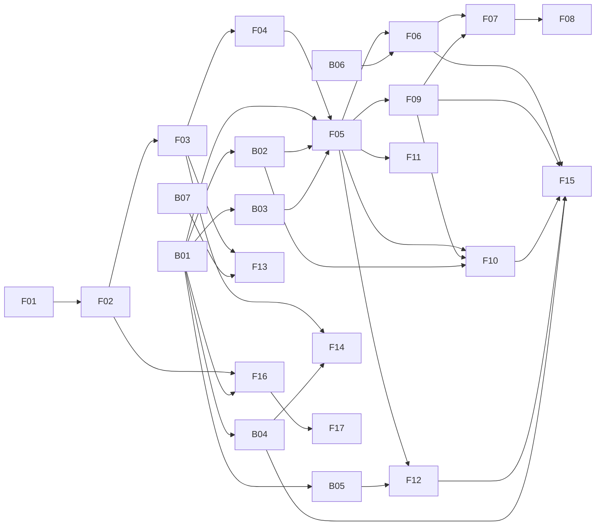

# Frontend TheraSuite – tikety a poradie

Návrh: `HLD-frontend.md` (architektúra, offline, záťaž, bezpečnosť) a `DLD-frontend.md` (detailný návrh, na ktorý odkazujú tikety). Tikety sú vo formáte šablóny „Úloha pre AI agenta“, rovnako ako prototyp backendu (`docs/prototyp/`).

- **B01–B07** – doplnky backendu, ktoré frontend potrebuje
- **F01–F17** – frontend (React + Tauri)
- **Návrh obrazoviek** – `ui/` (kópia) a živé plátno https://claude.ai/artifact/FNHjH1bPXuxz3gij9bmbyE; farby a písmo v `ui/README.md`

## Tikety

| # | Jira | Tiket | Závisí od |
|---|---|---|---|
| B01 | TK-18 | Konfigurácia klienta, počítadlo zmien recepcie a ETag | – |
| B02 | TK-19 | Príchody a odchody recepcie | B01 |
| B03 | TK-20 | Hromadný detail rezervačných kariet pre offline režim | B01 |
| B04 | TK-21 | Audit zobrazení z lokálnej kópie | B01 |
| B05 | TK-22 | Zoznam hostí pre lekára (JSON, CSV) | B01 |
| B06 | TK-23 | Nastavenia používateľa | – |
| B07 | TK-24 | Zoznam rolí a oprávnení | – |
| F01 | TK-25 | Kostra frontendu (web režim) | – |
| F02 | TK-26 | Tauri obal, HTTP a SSE cez natívne jadro | F01 |
| F03 | TK-27 | Prihlásenie, zmena hesla a oprávnenia v UI | F02 |
| F04 | TK-28 | Lokálny šifrovaný trezor a prihlásenie bez servera | F03 |
| F05 | TK-29 | Stav spojenia, synchronizácia, režim len na čítanie | F04, B01, B02, B03 |
| F06 | TK-30 | Plán ubytovania – zobrazenie a živé zmeny | F05, B06 |
| F09 | TK-33 | Rezervačné karty: vyhľadávanie a detail | F05 |
| F07 | TK-31 | Ubytovanie klienta z karty a z plánu | F06, F09 |
| F08 | TK-32 | Zmeny ubytovania: presun, dĺžka, výmena, odkladisko | F07 |
| F10 | TK-34 | Príchody a odchody | F05, F09, B02 |
| F11 | TK-35 | Nočná uzávierka | F05 |
| F12 | TK-36 | Zoznam hostí pre lekára | F05, B05 |
| F13 | TK-37 | Administrácia používateľov | F03, B07 |
| F14 | TK-38 | Audit | F03, B04 |
| F15 | TK-39 | Denník zobrazení z lokálnej kópie | F06, F09, F10, F12, B04 |
| F16 | TK-40 | Aktualizácie a kompatibilita verzie | F02, B01 |
| F17 | TK-41 | Inštalačný balík MSI | F16 |



## Odporúčané poradie

Backend a frontend môžu ísť súbežne v dvoch radoch; v rámci radu spúšťajte tikety **po jednom, až keď je predchádzajúci PR zlúčený** (agent vychádza z hlavnej vetvy).

1. **Backend:** B01 → B02 → B03 → B04 → B05 → B06 → B07
2. **Frontend:** F01 → F02 → F03 → F04 → (po B01–B03) F05 → F06 → F09 → F07 → F08 → F10 → F11 → F12 → F13 → F14 → F15 → F16 → F17

F13 a F14 nezávisia od offline časti, takže ich môžete po F03 (a B07/B04) spustiť aj skôr.

## Čo treba spraviť ručne (mimo dosahu agenta)

- **CI workflow** (`.github/workflows/` agent nemení): pridať Node 22, `npm ci`, `npm run lint`, `npm test -- --run`, `npm run build` v `frontend/`; pre `frontend/src-tauri/crates/vault` `cargo test`. Build MSI (F17) na Windows runneri, alebo lokálne.
- **F02 a F17** obsahujú ručné overenie na Windows – agent na Linuxe ich nevie spustiť, PR treba vyskúšať lokálne.
- **Kľúč na podpis aktualizácií** (F16) vygenerovať raz (`npm run tauri signer generate`) a súkromný kľúč uložiť mimo repozitára.

## Jira

Tikety sú založené v Jire, projekt TK, epic **TK-17** (štítok `frontend-1`), závislosti ako väzby „blocks“. Skript nižšie už netreba spúšťať, je len pre prípad, že by ste chceli GitHub issues.

## Ako tikety založiť (GitHub, voliteľne)

Skript `vytvor-tikety.ps1` v tomto priečinku (verzia skriptu z prototypu pre kódy B a F):

```powershell
cd "C:\Users\...\git\DevPod\TK"
powershell -ExecutionPolicy Bypass -File docs\frontend\vytvor-tikety.ps1 -TicketsPath docs\frontend\tickets -DryRun
```

Bez `-DryRun` založí 24 issues so štítkom `frontend-1` a odkazy `[F05]` nahradí číslami issues. Agenta spustíte pridaním štítku `ai-agent`.

## v2 – úpravy po teste (19. 11. 2026)

Epic **TK-42** (štítok `frontend-2`). Návrh obrazoviek: `ui/Stavy`, `ui/KartaV2`, `ui/NovaRezervacia`, `ui/PlanV2`, `ui/PrichodyV2`, `ui/UzavierkaReport`.

| # | Jira | Tiket | Závisí od |
|---|---|---|---|
| B08 | TK-43 | Stavy karty: príchod, odchod, storno, neprišiel | – |
| B09 | TK-44 | Uzávierka: stav Neprišiel a report dňa s obsadenosťou | B08 |
| B10 | TK-45 | Poznámka a komentáre ku karte | – |
| B11 | TK-46 | Nová karta s vyhľadaním klienta a pridelením lôžka | B10 |
| F21 | TK-50 | Navigácia Späť a drobčeky | – |
| F18 | TK-47 | Stavy karty v aplikácii (karta, plán, príchody) | B08, F21 |
| F19 | TK-48 | Nová rezervácia (aj z plánu) | B11, F18, F21 |
| F20 | TK-49 | Poznámka a komentáre na karte | B10, F18 |
| F22 | TK-51 | Report uzávierky, tlač a archív | B09, F21 |

Poradie: backend B08 → B09 a B10 → B11; frontend F21 hneď, potom F18 → F19, F20, F22 podľa hotového backendu.
