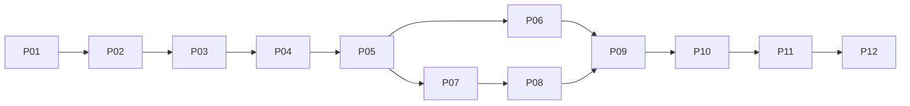

# Prvý prototyp – backend ubytovania

**Cieľ prototypu:** recepčná sa prihlási, vidí plán ubytovania nad demo dátami, ubytuje hosťa z rezervačnej karty a presťahuje ho. Druhá recepčná vidí zmenu hneď naživo. Každý zápis aj čítanie osobných údajov je v audite a obchodný deň sa mení nočnou uzávierkou.

Návrh: `docs/HLD-ubytovanie.md` (v4). Tikety sú vo formáte šablóny „Úloha pre AI agenta“.

## Fiktívne dáta

Demo a testovacie dáta sú **len fiktívne**: žiadne skutočné mená, adresy, kontakty, rodné čísla ani čísla dokladov (OP, pas). Ak je údaj potrebný, použije sa zjavne vymyslená hodnota (napr. „Ukážková 1, 000 00 Demovo“, doklad `XX000000`, e-mail `@example.invalid`). Demo dáta v `demo-data/` sú takto pripravené a skontrolované; to isté platí pre všetko, čo vytvorí agent.

## Tikety a poradie

| # | Tiket | Závisí od | Use casy |
|---|---|---|---|
| P01 | Kostra backendu | – | – |
| P02 | Katalóg ubytovacích kapacít a demo dáta | P01 | – |
| P03 | Používatelia, roly, oprávnenia a prihlásenie | P02 | – |
| P04 | Audit zápisov | P03 | – |
| P05 | Klienti a rezervačné karty | P04 | – |
| P06 | Audit čítania osobných údajov | P05 | – |
| P07 | Recepcie, obchodný deň a nočná uzávierka | P05 | – |
| P08 | Doména: interval pobytu a kontrola obsadenosti | P07 | – |
| P09 | Pobyty a ubytovanie klienta | P06, P08 | UC1, UC2, UC4 |
| P10 | Plán ubytovania | P09 | UC15, UC16, UC18 |
| P11 | Zmeny ubytovania: sťahovanie, dĺžka, dávka, výmena | P10 | UC7–UC11, UC19 |
| P12 | Živé aktualizácie plánu (SSE) | P11 | – |



P06 a P07 môžu bežať súbežne. Ostatné tikety spúšťajte **po jednom, až keď je predchádzajúci PR zlúčený**, lebo agent vždy vychádza z hlavnej vetvy.

## Mimo prvého prototypu

Kategória pre cenu (UC12–UC14), správa blokácií a filtrov (UC17, UC20), hromadné ubytovanie (UC5, UC6), kontingenty (UC21–UC24), zoznam hostí pre lekára a prevzatie pacienta, oznámenia a e-maily, uchovávanie a archivácia auditu, nasadenie u zákazníka, nastavenia používateľa, frontend.

## Ako tikety spustiť

1. **Podklady do repozitára.** Agent na GitHube vidí len to, čo je v repozitári. Skopírujte a pushnite do hlavnej vetvy:
   - `docs/HLD-ubytovanie.md`
   - celý priečinok `prototyp/demo-data/` ako `docs/demo-data/`
2. **Založte issues** skriptom (z priečinka repozitára, potrebuje prihlásené `gh`):
   ```powershell
   cd "C:\cesta\k\repozitaru"
   powershell -ExecutionPolicy Bypass -File "C:\Projects\DevPod\prototyp\vytvor-tikety.ps1" -TicketsPath "C:\Projects\DevPod\prototyp\tickets"
   ```
   Skript založí 12 issues so štítkom `prototyp-1` a odkazy na závislosti doplní ako `#číslo`. S prepínačom `-DryRun` len vypíše, čo by spravil.
3. **Spúšťajte po jednom:** na issue P01 pridajte štítok `ai-agent`. Po zlúčení PR pokračujte P02 atď.
4. **Kontrola PR:** pred zlúčením si pozrite hlavne migrácie (názvy tabuliek a stĺpcov podľa HLD) a testy.

## Ukážka hotového prototypu

Spustenie: `docker compose up -d postgres` a `./mvnw spring-boot:run -Dspring-boot.run.profiles=demo` (Swagger UI na `http://localhost:8080/swagger-ui.html`).

1. Prihlásiť sa ako `recepcna.hlavna` / `Demo123!` (`POST /api/auth/login`).
2. `GET /api/accommodation-plan?from=…&to=…` – plán s pásikmi, držanými lôžkami a blokáciami.
3. Vyhľadať kartu v stave `RESERVED` bez pobytu, `GET /api/rooms/available` a ubytovať ju (`POST /api/reservations/{id}/stays`).
4. V druhom okne prihlásiť `veduca` a otvoriť `GET /api/events`.
5. Presťahovať pobyt (`POST /api/stays/{id}/move`) – vo druhom okne príde `plan-changed`.
6. Ako `auditor` pozrieť `GET /api/audit/events` a `GET /api/audit/clients/{id}/access`.
7. Ako `veduca` spustiť `POST /api/receptions/1/business-day/close/preview` – ukážu sa neodhlásení hostia a no-show z demo dát.
